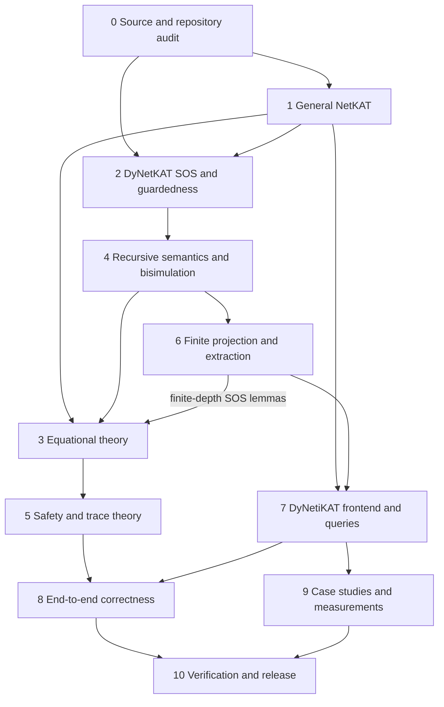

# DyNetKAT-Lean roadmap

## Objective and sources

Deliver a complete Lean 4 formalization of the mathematics in Caltais, Hojjat,
Mousavi and Tunç, *DyNetKAT: An Algebra of Dynamic Networks*, and a usable
implementation of the original DyNetiKAT analysis workflow. Mathematical
references use [arXiv:2102.10035v4](https://arxiv.org/abs/2102.10035v4)
(22 May 2021). [PAPER_CONFORMANCE.md](docs/PAPER_CONFORMANCE.md) maps it to
[FoSSaCS 2022, LNCS 13242, pp. 184–204](https://doi.org/10.1007/978-3-030-99253-8_10)
and to the current Lean definitions. Tool parity targets
[DyNetiKAT v1.1](https://gitlab.utwente.nl/fmt/dynetikat/-/tree/v1.1),
commit `1c6bd422377853378c7516a7875009fcfb5ba881`. The later journal
development on logs, causal analysis and schedules lies outside this scope.

[PROOF_OBLIGATIONS.md](docs/PROOF_OBLIGATIONS.md) is the proof ledger.
[DYNETIKAT_REFERENCE_AUDIT.md](docs/DYNETIKAT_REFERENCE_AUDIT.md#v11-feature-parity)
is the tool feature ledger. [NETKAT_AUDIT.md](docs/NETKAT_AUDIT.md) records the
packet model and backend scope. The [S6C audit](docs/S6C_TAIL_EXTRACTION_AUDIT.md)
and other specialist notes retain their historical findings. Use the current
ledgers for status and paper references.

## Dependencies

The phases are workstreams. In particular, the derivation rules can be
specified early, while their completeness proof consumes results from the
recursion and projection workstreams.

### Phase 0 — Conformance audit

Use the pinned editions, immutable tool revision, and working-tree evidence in
the three ledgers. The source and coverage audit is recorded. The release gate
also requires checking the open interpretation issues against the formal
statements and executing the original artifact baseline in Phase 9.

### Phase 1 — General NetKAT foundations

Parameterize the finite field schema and each field's value type. Preserve a
fixed-domain instance for existing regressions. Prove complete tests and
assignments, relational and history correspondence, exact star, and exact
zero and equivalence. Complete Figure 4 and its soundness and completeness
proofs, including Lemma 5 for the dup-free calculus. Model full NetKAT and
`dup` in the supporting foundation for the literal Figure 4 target. Keep
DyNetKAT prefixes and payloads dup-free. Build a proved finite reference
evaluator and investigate a verified symbolic backend or certificate checker
against the FatTree workload. The [NetKAT audit](docs/NETKAT_AUDIT.md) gives
the backend proof and measurement gates.

### Phase 2 — Complete DyNetKAT language and SOS

Lift the existing AST, packet lists, action labels and all base and extended
rules to the general packet schema. For the current typed grammar,
`TypedPaperGuarded` is proved equivalent to `GuardedOccurrences`.
`ClosedDefined` provides one body per reachable name and `WellFormed`
checks those bodies. A closed entry point such as `Host || Switch` can
expose references. Record the exact payload
equality used in SOS, restriction and derivability. Discharge the inversions,
atomic packet behavior and alphabet support required downstream.

### Phase 3 — Complete algebraic theory

Formalize equational derivability and the NetKAT import boundary, including
A0–A15, four restriction axioms, four projection axioms, named definitions
and the infinitary AIP rule. Prove each axiom instance and Lemma 10 under the
resolved side conditions. Use Phase 4 branching and Phase 6 projection
lemmas for AIP and Theorem 1. Lemma 9 is proved for `CtxPkt` by
`guarded_normalizes` and `WellFormed.normalizes`, which derive finite
head normal forms with arbitrary continuations. Theorem 1 is proved for
variable-free `CtxPkt` terms by `ground_derives_iff_bisimilar`. The reverse
direction uses summand matching and induction on process-prefix counts in
`DerivesNoAIP`. Completeness for recursive entry terms remains separate.

### Phase 4 — Recursive semantics and bisimulation

Prove general finite branching for the actual closed guarded domain, including
derivatives. Resolve root references, mutual recursion and finite support for
finite specifications. Prove guarded reference resolution and finite exact
one-step enumeration under the paper's assumptions. Complete Proposition 1
and Lemma 3 with all histories and unchanged labels, including the chosen
recursive binding rules. Generalize the existing finite-support graph/SOS
correspondence and connect independent closed graphs to the paper's
bisimilarity, including name independence and agreement with source closure.

### Phase 5 — Full safety-property theory

Implement Definitions 12–17, including desugaring, word sums, finite
alphabets, guarded universal process, prefix avoidance and A16. Prove
language preservation, the trace semantics of the translation, and the
conditions under which trace inclusion is equivalent to the derivability
equation. Prove a bounded decision theorem for finite forbidden words and
validate both sides of the firewall workflow and the distributed-controller
example. Track the full all-length statement separately from an individual
bounded verdict. Include the positive reachability dual used in §V.

### Phase 6 — Extraction and normalization

Make exact projection of closed guarded processes the general executable
route. Derive finite one-step rows over local SOS premises, then recurse on
remaining transition depth. Preserve interleaving and both synchronization
orientations. The full symbolic row is computed before outer communication
restriction, so a matching send and receive can still produce an observable
reconfiguration. Support the paper's restriction semantics and nested
projections, and prove bisimulation with the source SOS at every finite
depth. Validate head and repeated tail against the equations and original
projected SOS, including cutoffs and unmatched events. The finite-derivative
certificate may accelerate suitable inputs with a proof that the optimization
preserves the selected depth and query semantics.

### Paper-faithful recursive execution acceleration

`renderProjection` is the semantic reference. `renderProjectionMemo`
adds a per-render cache for pairs of certified state keys and remaining
depth. It preserves the exact rendered term, including row order,
restriction and synchronization. The default key admits only chains of
packet, send, receive or reconfiguration prefixes ending in a reference or
deadlock. References use the fixed graph and definition classifiers.
Compound and opaque restriction states fall back to the same depth
recursion. Caller-supplied keys require a proof of rendering equality
before reuse. Hits return the stored subtree directly. Finite quotient
discovery remains a separate milestone.

The separate `DependencySCC` analysis computes the reachable
definition graph and its SCCs from a finite support. Condensation edges
strictly decrease a certified reachability rank. An acyclic graph admits
finite administrative unfolding to a ground process. A guarded cyclic
component describes syntactic recursion and carries no derivative bound.
Quotient discovery and strategy selection remain separate.

### Phase 7 — Full DyNetiKAT functionality

Provide a usable CLI for the v1.1 program and JSON schema, recursive
declarations, channels and packet predicates. Support reachability,
non-reachability, waypointing, nested dynamic head/tail queries, per-query
projection depth and multiple properties and packet pairs. Provide checked
preprocessing or a validated reusable representation, worker control and
timing and per-property verdicts. Match meaningful v1.1 behavior and document
parser and error-handling decisions. Internal backend paths and subprocess
formats are replaceable. Also expose the broader safety language of Phase 5.

### Phase 8 — End-to-end formal correctness

Connect accepted input bytes and declared field domains to typed syntax and
environments, then to restriction, exact projection, extraction, NetKAT
queries and reported verdicts. Prove Boolean soundness and completeness for
each query class on its stated domain. Relate waypoint inclusion to the
original backend formula and separately discharge any claimed universal
path interpretation. Show caching, certificate checks and worker scheduling
preserve results and that errors remain distinct from property violations.

### Phase 9 — Benchmark and experimental parity

Run the pinned firewall and both distributed-controller variants. Reproduce
the six FatTrees (6, 8, 10, 12, 14 and 16 pods, through 1,344 switches).
Check non-SSH reachability and SSH isolation at each of the four update
prefixes and waypointing through the new firewall after the last update.
Compare individual property groups and the combined parallel workload.
Pin generator inputs, backend revisions, dependencies, host and worker count.
Record ten runs per paper configuration where feasible and report individual
runs, wall time, CPU and peak memory. Measure preprocessing, projection and
extraction, and NetKAT solving separately, including reuse of preprocessing.
Record any baseline failures and keep them out of performance comparisons.
Make any performance-parity claim conditional on comparable measurements.

### Phase 10 — Verification and release

Cross-check the paper and tool ledgers item by item. Build the complete Lean
library and CLI, review theorem statements and trusted dependencies, and run
all tests and pinned examples in a reproducible release workflow. Publish a
schema and examples, documented assumptions and known limitations, and the
benchmark methodology and results.

## Completion conditions

1. Every relevant paper definition and rule has a Lean representation and
   every claimed result has an imported machine-checked theorem matching
   the audited statement and assumptions.
2. E_NK and E_DNK have sound and ground-complete derivability, including the
   dup-free normalization corollary, exact A15 side conditions and guarded
   AIP. Any necessary correction to a literal printed claim has a recorded
   counterexample or source justification and an explicit corrected theorem.
3. All syntax and SOS cases, closed guarded recursion and arbitrary finite
   projection depth are supported. Regression witnesses include an infinite
   unbounded derivative family and communication beneath parallel and
   restriction.
4. Definitions 12–17, the trace characterization and the supported reduction
   to executable safety verdicts are proved. Head and nested tail queries
   agree with the source semantics at the requested depth.
5. The CLI runs v1.1 reachability, non-reachability and dynamic waypointing
   queries on general finite schemas. Parser-to-verdict theorems and
   frontend error and batch regressions are part of the release.
6. The original firewall and FatTree suite through 1,344 switches runs with
   reproducible results. Runtime, peak memory and preprocessing are measured
   and compared with the original prototype under recorded conditions.
7. All remaining interpretation decisions and any deviation in functionality
   are explicit in the release ledger. The build and proof audit contain no
   proof holes or unchecked assumptions replacing required theorems.

## Next implementation milestone

Prove exact one-step enumeration for closed guarded definitions and use it to
render `π_n` into a finite sequential term or graph at any user-selected depth.
Start with the current packet instance, with the schema boundary explicit so
Phase 1 can proceed independently. The milestone passes when the renderer is
total on the stated guarded domain, matches the original SOS in both
directions with identical labels and packet-list effects, and computes
projected versions of the parallel spawning example and original firewall
without a supplied derivative certificate. Cover depth zero, a synchronization
at the cutoff, mutual recursion, nested restriction and both merge operators.
The statement and proof order are specified in
[PROOF_OBLIGATIONS.md](docs/PROOF_OBLIGATIONS.md#finite-depth-projection).

### Recursive analysis and concrete certificates

Use reachable dependency SCCs to select the analysis route. An acyclic
dependency graph gives the administrative ground unfolding theorem. On
cyclic inputs, try finite concrete closure with explicit state, transition
and worklist limits. A checked closure covers the reachable graph processes
at every depth and supports lifting arbitrary predicates on those processes.
When discovery runs out of resources or cannot establish identity, use exact
finite projection for the requested depth under its existing hypotheses.

Finite bisimulation discovery tries all matching symbolic alternatives in
the product of two concrete closures and checks the resulting relation.
Use explicit finite abstract tables when concrete closure is unavailable.
Forward certificates transfer all-depth state properties. Strong quotient
certificates also certify each abstract transition in reverse and relate
the root to the rendered DyNetKAT model. Exact finite projection remains
available when no suitable certificate has been supplied.

The spawning fixture admits a finite forward abstraction, and the
unspent blocker count rules out every finite strong quotient. A minimal
variant that spawns deadlocks has infinitely many concrete derivatives
and a one-state strong quotient. The certified strategy API selects
routes for bounded inspection, all-depth state properties, and exact
models. Pairwise equivalence can
use a checked finite bisimulation, a strong quotient, or a direct proof.
Future work includes candidate inference, executable query-specific
property checkers, CLI reporting, and the KATch, general-packet and
tool-parity phases.

### Checked NetKAT backend candidates

The fixed-domain checker accepts a proposed shared packet relation or a
distinguishing input, validates it against the exact evaluator, and
otherwise falls back to the existing decision procedure. The optional
NKPL exporter and JSON interchange are outside the semantic proof.
A live KATch adapter and timing comparison against a symbolic certificate
format remain open. The current positive checker still evaluates both
policies on every input.
