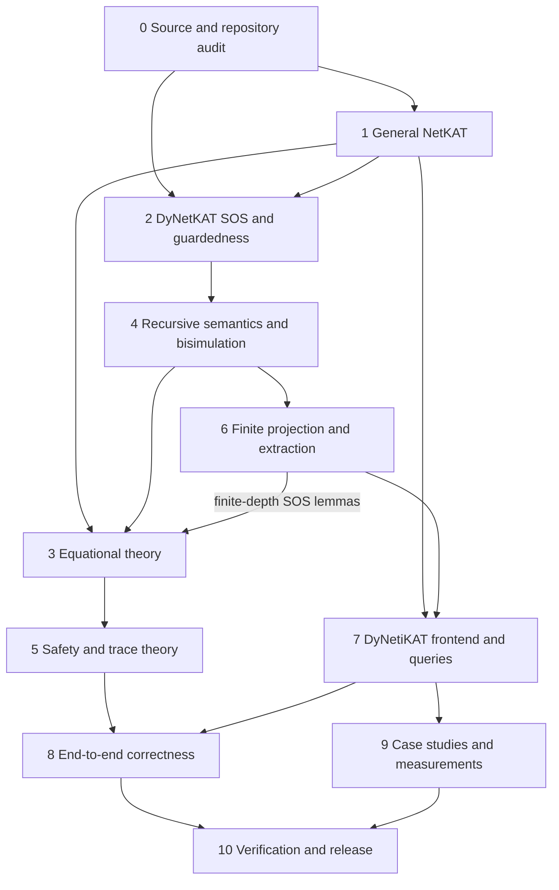

# DyNetKAT-Lean roadmap

## Symbolic native KAT

`KATLean.Native` decides the pure KAT equational theory using reduced ordered
Boolean decision trees and symbolic partial derivatives.
`decideEquiv_iff_equational` characterizes derivability from the KAT rules and
`decideEquiv_iff_algebraicallyEquivalent` characterizes equality in every
abstract KATLean model. `nativeSolver_derives` yields a NetKAT derivation
under any substitution of primitive actions and tests.

`netkatNativeEquiv` adds executable symbolic equivalence for the current
dup-free NetKAT AST. KATLean → native KAT → symbolic packet frontend →
NetKAT equivalence → E_NK → E_DNK is the resulting proof path.
`netkatNativeEquiv_correct` is independent of KATch, concrete packet
enumeration and Boolean valuation enumeration. The E_NK completeness proof
uses symbolic closure and the field-level partition axiom. The public
`netkatEquiv` and `netkatIsZero` APIs serve graph normalization and safety
through the symbolic checker. `legacyNetkatEquiv` is the regression oracle.

See the [symbolic frontend and dependency audit](docs/NETKAT_AUDIT.md).

See [NATIVE_KAT.md](docs/NATIVE_KAT.md) for the theorem chain and proof construction.

## Native equivalence and normalization

The core path is KATLean → verified native equivalence → symbolic dup-free
NetKAT → E_NK → E_DNK. Native pure-KAT algebraic completeness now uses finite
partial-derivative systems and the existing symbolic search.

The symbolic frontend covers the dup-free AST. Equality and zero checks in
graph and safety analysis now use it. The direct E_NK proof discharges
input observations with field-level partitions and certifies star through
the symbolic fixed point. Lemma 5 and DyNetKAT packet-head normalization
share the symbolic relation diagram. They materialize only accepted pairs
when the paper requires explicit branches. The complete-pair statement is
unchanged. Graph normalization retains one symbolic policy per packet
label. Concrete execution starts from the supplied input and its star
proof bounds growth of the reached sets. Core equivalence, normalization,
graph normalization, safety and execution correctness are independent of
full packet enumeration. The exhaustive reference code is available
through `DyNetKAT.NetKAT.Legacy`.
Concrete witness extraction and diagram sharing are future work.
[Design and enumeration audit](docs/NATIVE_KAT.md).

## Objective and sources

Deliver a complete Lean 4 formalization of the mathematics in Caltais, Hojjat,
Mousavi and Tunç, *DyNetKAT: An Algebra of Dynamic Networks*, and a usable
implementation of the original DyNetiKAT analysis workflow. Mathematical
references use [arXiv:2102.10035v4](https://arxiv.org/abs/2102.10035v4)
(22 May 2021). [PAPER_CONFORMANCE.md](docs/PAPER_CONFORMANCE.md) maps it to
[FoSSaCS 2022, LNCS 13242, pp. 184–204](https://doi.org/10.1007/978-3-030-99253-8_10)
and to the current Lean definitions. Tool parity targets
[DyNetiKAT v1.1](https://gitlab.utwente.nl/fmt/dynetikat/-/tree/v1.1),
commit `1c6bd422377853378c7516a7875009fcfb5ba881`. The later journal
development on logs, causal analysis and schedules lies outside this scope.

[PROOF_OBLIGATIONS.md](docs/PROOF_OBLIGATIONS.md) is the proof ledger.
[DYNETIKAT_REFERENCE_AUDIT.md](docs/DYNETIKAT_REFERENCE_AUDIT.md#v11-feature-parity)
is the tool feature ledger. [NETKAT_AUDIT.md](docs/NETKAT_AUDIT.md) records the
packet model and optional backend experiments. The [S6C audit](docs/S6C_TAIL_EXTRACTION_AUDIT.md)
and other specialist notes retain their historical findings. Use the current
ledgers for status and paper references.

## Core formalization architecture

The paper-facing path starts with the source grammar and the
`Program` / reachable `Residual` boundary, then follows the SOS semantics,
KATLean, dup-free NetKAT E_NK, DyNetKAT E_DNK and certified analysis.
Mathlib supplies the KA structure used by KATLean. The NetKAT evaluator,
Derives and normalization results are connected to that algebra by Lean
theorems. The dependency diagram below records proof workstreams within
this architecture.

KATch belongs to optional experimental tooling. Its availability is not a
premise of any core theorem, analysis route or completion condition.
`import DyNetKAT` exposes the core. `import DyNetKAT.Experimental`
adds the preserved backend comparison and candidate-checking exports.

## Dependencies

The phases are workstreams. In particular, the derivation rules can be
specified early, while their completeness proof consumes results from the
recursion and projection workstreams.

### Phase 0 — Conformance audit

Use the pinned editions, immutable tool revision, and working-tree evidence in
the three ledgers. The source and coverage audit is recorded. The release gate
also requires checking the open interpretation issues against the formal
statements and executing the original artifact baseline in Phase 9.

### Phase 1 — General NetKAT foundations

Parameterize the finite field schema and each field's value type. Preserve a
fixed-domain instance for existing regressions. Prove complete tests and
assignments, dup-free relational/history correspondence, exact star, and
exact zero and equivalence through the native symbolic packet layer, without
exhaustive packet enumeration in core decisions or proof foundations. Complete
the dup-free Figure 4 soundness and
completeness proofs, including Lemma 5, using KATLean over Mathlib KA.
DyNetKAT prefixes and payloads use the dup-free calculus. Full NetKAT
with `dup` and its history-changing semantics is a supporting extension
outside current DyNetKAT completion. Build a proved reference evaluator
and measure its behavior on the FatTree workload. The
[NetKAT audit](docs/NETKAT_AUDIT.md) gives the query proof and measurement gates.

### Phase 2 — Complete DyNetKAT language and SOS

Lift the existing AST, packet lists, action labels and all base and extended
rules to the general packet schema. For the current typed grammar,
`TypedPaperGuarded` is proved equivalent to `GuardedOccurrences`.
`ClosedDefined` provides one body per reachable name and `WellFormed`
checks those bodies. A closed entry point such as `Host || Switch` can
expose references. Record the exact payload
equality used in SOS, restriction and derivability. Discharge the inversions,
atomic packet behavior and alphabet support required downstream.

### Phase 3 — Complete algebraic theory

Formalize equational derivability and the NetKAT import boundary, including
A0–A15, four restriction axioms, four projection axioms, named definitions
and the infinitary AIP rule. Prove each axiom instance and Lemma 10 under the
resolved side conditions. Use Phase 4 branching and Phase 6 projection
lemmas for AIP and Theorem 1. Lemma 9 is proved for `CtxPkt` by
`guarded_normalizes` and `WellFormed.normalizes`, which derive finite
head normal forms with arbitrary continuations. Theorem 1 is proved for
variable-free `CtxPkt` terms by `ground_derives_iff_bisimilar`. The reverse
direction uses summand matching and induction on process-prefix counts in
`DerivesNoAIP`. Completeness for recursive entry terms remains separate.

### Phase 4 — Recursive semantics and bisimulation

Prove general finite branching for the actual closed guarded domain, including
derivatives. Resolve root references, mutual recursion and finite support for
finite specifications. Prove guarded reference resolution and finite exact
one-step enumeration under the paper's assumptions. Proposition 1 is proved
for all histories over `CtxPkt` and a shared continuation in any fixed
environment. `Program.historySemantics_iff_packetPrefix_bisimilar` covers
admitted base-sorted continuations, including recursive ones. Complete the
general-schema and recursive-binding scope of Lemma 3. Generalize the existing
finite-support graph/SOS correspondence and connect independent closed graphs to the paper's
bisimilarity, including name independence and agreement with source closure.

### Phase 5 — Full safety-property theory

Definitions 12–16 and Eq. (27) are proved over the admitted `CtxPkt`
domain and the supplied finite safety alphabet. Definition 17's explicit
desugaring clauses and the all-length Eq. (28) padding theorem are proved.
The word checker is exact for supplied forbidden words using certified
symbolic moves, with a completeness bound
given by the longest forbidden word. Its semantic specification and trace
derivability theorem use all source traces. See the
[v4 crosswalk](docs/PAPER_CONFORMANCE.md#safety-property-theory).
The §V positive witness equation and the feasible head/tail source bridge
are machine checked. The distributed-controller and FatTree case studies
remain open.

### Phase 6 — Extraction and normalization

Exact projection and sequential preprocessing give
`projectedReachability_correct` for head and nested tails at a specified
source depth on guarded networks with finite definition support.
`normalizedReachability_correct` gives the all-depth alternative under a
finite derivative certificate. Both preserve the source actions and
exclude impossible packet prefixes. The executable finite rendering is
also derivable in E_DNK without AIP via `renderProjection_derives`.
`Program.Compiled.State.renderProjectionTotal_derives` covers the total
renderer used by the bounded strategy. Neither proof needs global finite
derivative closure. General schemas and parser integration remain open.

### Paper-faithful recursive execution acceleration

`renderProjection` is the semantic reference. `renderProjectionMemo`
adds a per-render cache for pairs of certified state keys and remaining
depth. It preserves the exact rendered term, including row order,
restriction and synchronization. The default key admits only chains of
packet, send, receive or reconfiguration prefixes ending in a reference or
deadlock. References use the fixed graph and definition classifiers.
Compound and opaque restriction states fall back to the same depth
recursion. Caller-supplied keys require a proof of rendering equality
before reuse. Hits return the stored subtree directly. Finite quotient
discovery remains a separate milestone.

The separate `DependencySCC` analysis computes the reachable
definition graph and its SCCs from a finite support. Condensation edges
strictly decrease a certified reachability rank. An acyclic graph admits
finite administrative unfolding to a ground process. A guarded cyclic
component describes syntactic recursion and carries no derivative bound.
Quotient discovery and strategy selection remain separate.

### Phase 7 — Full DyNetiKAT functionality

Provide a usable CLI for the v1.1 program and JSON schema, recursive
declarations, channels and packet predicates. Support reachability,
non-reachability, waypointing, nested dynamic head/tail queries, per-query
projection depth and multiple properties and packet pairs. Provide checked
preprocessing or a validated reusable representation, worker control and
timing and per-property verdicts. Match meaningful v1.1 behavior and document
parser and error-handling decisions. Internal backend paths and subprocess
formats are replaceable. Also expose the broader safety language of Phase 5.

### Phase 8 — End-to-end formal correctness

Connect accepted input bytes and declared field domains to typed syntax and
environments, then to restriction, exact projection, extraction, NetKAT
queries and reported verdicts. Prove Boolean soundness and completeness for
each query class on its stated domain. Relate waypoint inclusion to the
original backend formula and separately discharge any claimed universal
path interpretation. Show caching, certificate checks and worker scheduling
preserve results and that errors remain distinct from property violations.

### Phase 9 — Benchmark and experimental parity

Run the pinned firewall and both distributed-controller variants. Reproduce
the six FatTrees (6, 8, 10, 12, 14 and 16 pods, through 1,344 switches).
Check non-SSH reachability and SSH isolation at each of the four update
prefixes and waypointing through the new firewall after the last update.
Compare individual property groups and the combined parallel workload.
Pin generator inputs, backend revisions, dependencies, host and worker count.
Record ten runs per paper configuration where feasible and report individual
runs, wall time, CPU and peak memory. Measure preprocessing, projection and
extraction, and NetKAT solving separately, including reuse of preprocessing.
Record any baseline failures and keep them out of performance comparisons.
Make any performance-parity claim conditional on comparable measurements.

### Phase 10 — Verification and release

Cross-check the paper and tool ledgers item by item. Build the complete Lean
library and CLI, review theorem statements and trusted dependencies, and run
all tests and pinned examples in a reproducible release workflow. Publish a
schema and examples, documented assumptions and known limitations, and the
benchmark methodology and results.

### Phase 11: Post-development packaging and reproducibility

After the paper and parity work reaches a clean, verified development
baseline, carry out the [modularization plan](docs/MODULARIZATION_PLAN.md).
The future target is three independently consumable Lake packages,
KATLean, NetKATLean, and DyNetKATLean, initially in this repository.
External consumer tests, a coordinated naming migration, and retirement
of development-only comparisons belong to this deferred phase.

## Completion conditions

1. Every relevant paper definition and rule has a Lean representation and
   every claimed result has an imported machine-checked theorem matching
   the audited statement and assumptions.
2. Dup-free E_NK and E_DNK have sound and ground-complete derivability, including the
   dup-free normalization corollary, exact A15 side conditions and guarded
   AIP. Any necessary correction to a literal printed claim has a recorded
   counterexample or source justification and an explicit corrected theorem.
3. All syntax and SOS cases, closed guarded recursion and arbitrary finite
   projection depth are supported. Regression witnesses include an infinite
   unbounded derivative family and communication beneath parallel and
   restriction.
4. Definitions 12–17, the trace characterization and the supported reduction
   to executable safety verdicts are proved. Head and nested tail queries
   agree with the source semantics at the requested depth.
5. The CLI runs v1.1 reachability, non-reachability and dynamic waypointing
   queries on general finite schemas. Parser-to-verdict theorems and
   frontend error and batch regressions are part of the release.
6. The original firewall and FatTree suite through 1,344 switches runs with
   reproducible results. Runtime, peak memory and preprocessing are measured
   and compared with the original prototype under recorded conditions.
7. All remaining interpretation decisions and any deviation in functionality
   are explicit in the release ledger. The build and proof audit contain no
   proof holes or unchecked assumptions replacing required theorems.

## Next implementation milestone

Paper-facing analysis starts with `Program`, which checks the paper
source grammar and guarded reachable declarations. Its `Residual` type
requires an SOS path. `Program.Compiled` builds its graph from the admitted
source, and compiled residuals carry correspondence and graph reachability.
Finite branching, AIP, finite projection and the safety reduction remain
paper-core. Certified simulation and quotients are optional tools for
reachable residuals. Acyclic aliases in defining equations and synthetic
graph-only regressions belong to the internal proof and test infrastructure.

The first [KATLean foundation](docs/KATLEAN.md) is implemented using the
pinned Mathlib KA, an injective Boolean-test embedding and generic packet
lookup/update laws. The CtxPkt interpretation agrees with the evaluator,
and every existing NetKAT derivation preserves its interpretation.
`normalize_katInterp` connects the current Lemma 5 result to that algebra.
The derivation layer now uses KATLean directly for all 15 KA rules, six BA
laws, four test embeddings and seven packet laws. Semantic soundness follows
from that interpretation equality, and Lemma 5 and E_DNK consume this proof
chain. The remaining foundation work concerns general-schema bridges.
Full NetKAT history/dup coverage is an optional supporting extension.

### Recursive analysis and concrete certificates

Use reachable dependency SCCs to select the analysis route. An acyclic
dependency graph gives the administrative ground unfolding theorem. On
cyclic inputs, try finite concrete closure with explicit state, transition
and worklist limits. A checked closure covers the reachable graph processes
at every depth and supports lifting arbitrary predicates on those processes.
When discovery runs out of resources or cannot establish identity, use exact
finite projection for the requested depth under its existing hypotheses.

Finite bisimulation discovery tries all matching symbolic alternatives in
the product of two concrete closures and checks the resulting relation.
Use explicit finite abstract tables when concrete closure is unavailable.
Forward certificates transfer all-depth state properties. Strong quotient
certificates also certify each abstract transition in reverse and relate
the root to the rendered DyNetKAT model. Exact finite projection remains
available when no suitable certificate has been supplied.

The spawning fixture admits a finite forward abstraction, and the
unspent blocker count rules out every finite strong quotient. A minimal
variant that spawns deadlocks has infinitely many concrete derivatives
and a one-state strong quotient. The certified strategy API selects
routes for bounded inspection, all-depth state properties, and exact
models. Pairwise equivalence can
use a checked finite bisimulation, a strong quotient, or a direct proof.
Future work includes candidate inference, executable query-specific
property checkers, CLI reporting, general packet schemas and tool parity.

## Optional / experimental tooling

KATch is an external comparison point and possible future accelerator.
These experiments have their own validation obligations. They are outside
the core semantics, E_NK, E_DNK, completeness, normalization, certified
analysis and release criteria. Core proofs use NetKAT interpreted through
KATLean. Backend availability and successful live replay are optional
experiment prerequisites.

### Checked NetKAT backend candidates

The fixed-domain checker accepts a proposed shared packet relation or a
distinguishing input, validates it against the exact evaluator, and
otherwise falls back to the existing decision procedure. The optional
NKPL exporter and JSON interchange are outside the semantic proof.
The finite-relation checker still evaluates both policies on every input.

The optional KATch driver nominates distinguishing inputs through
guarded assertions and uses a positive assertion to trigger equational
replay on a supported fixture. The small, proved equational checker
avoids packet enumeration in its rewrite fragment. The pinned source
audit identified a masked Java exit status in the upstream shell launcher.
The driver checks complementary assertion messages and isolates KATch
output files. Both live replay paths passed against the pinned executable.
The pinned CLI discards its internal bisimulation worklist and has no
compact proof export. General packet schemas remain a separate phase.
