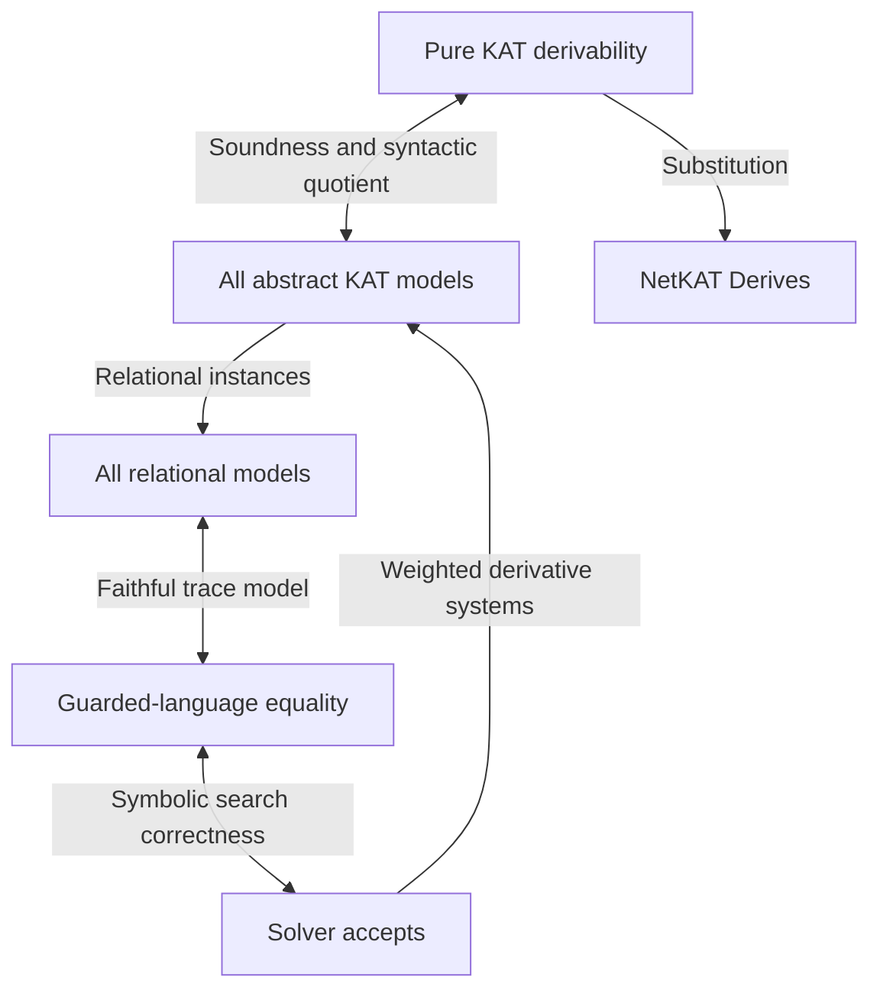

# Native KAT equivalence and algebraic completeness

## Status and exact scope

The current normalization work starts from `99050e5 add verified symbolic dup-free NetKAT equivalence solver`. The pure KAT guard milestone was `123fb24 replace native KAT valuation enumeration with symbolic guards`.
`import KATLean.Native` exposes an executable, sound-and-complete decision
procedure for the pure KAT equational theory over the native solver's finite
alphabets. It also decides guarded-string language equality, equality in all
relational KATLean models, and equality in all abstract KATLean models.

### Theorem dependencies



| Meaning | Definition and theorem |
|---|---|
| Equality in every relational model | `RelationalEquivalent` quantifies over state types, action relations and test sets. `relational_iff_language` uses the existing `Expr.interp Rel.tests` and a faithful trace model. |
| Equality of accepted guarded strings | `LanguageEquivalent` quantifies over initial atoms and words. `language_to_equational` derives a pure KAT proof. |
| Validity in every abstract KATLean model | `AlgebraicallyEquivalent` quantifies over `KAT K B` and interpretations of primitive names. `algebraicallyEquivalent_iff_equational` characterizes this validity. |
| Derivability from pure KAT rules | `Equational` is inductive. Its 15 KA laws, six BA laws, four test-embedding laws and congruence rules are sound by `Equational.algebraic_sound`. |
| Symbolic solver acceptance | `decideEquiv_iff_equational` and `decideEquiv_iff_algebraicallyEquivalent` connect the existing Boolean decision to both algebraic notions. |
| Substitution into NetKAT | `nativeSolver_derives` composes completeness with `nativeEquational_derives`. Two distinct actions may collapse under a NetKAT substitution, so the reverse implication fails in general. |

### Construction

The proof uses finite weighted affine systems over an arbitrary KAT. This route
reuses the native continuation bound, partial derivatives and reached symbolic
pair graph. It needs neither a separate translation to regular expressions nor
a second determinization.

1. `derivativeEquation_interp` shows that interpreting continuations gives a
   fixed point. `interp_le_derivativeEquation` proves leastness by syntax
   induction with an arbitrary right boundary. In the star case it uses
   Kleene star induction and the fact that every nullable test lies below one.
2. `FiniteSystem.solve_spec` eliminates one variable at a time. The pivot
   contributes its coefficient's star and is substituted into the remaining
   equations. `FiniteSystem.solve_intertwines` uses the left and right
   least-solution laws to show that rectangular incidence matrices transport
   solutions between finite systems.
3. The reachable pair graph gives one weighted system. Reified symbolic BDD
   labels on each pair transition agree with the two partial-derivative
   projections. `Test.interp_eq_of_eval` proves the needed test identities
   in arbitrary Boolean algebras by prime-ideal separation. It reasons with a
   separating valuation as a proof witness and constructs no valuation table.
   Both projections intertwine with the pair graph. Solver acceptance gives
   identical output guards at all reached pairs, so the two projections have
   equal least solutions at the initial singleton pair.
4. `TermModel` quotients the program and test sorts by derivability. Its
   Kleene algebra and Boolean embedding use the existing pure KAT rules.
   Interpreting syntax at the quotient generators reflects universal equality
   into `Equational`. No rule was added to the proof system.

A standard source for guarded-string completeness is
[Kozen and Smith, *Kleene Algebra with Tests: Completeness and Decidability*](https://ecommons.cornell.edu/entities/publication/3640eb22-7e95-4649-96d4-c60085ce6e75).
The native proof uses the finite symbolic pair system above.

### Canonical Boolean representation

`Boolean.Diagram n` is a pure ordered decision tree. The index fixes variable
order: a node consumes the first variable and its children have index `n`;
`skip` ignores a variable without duplicating a subtree. Constants are leaves.
`Reduced` excludes equal node branches and skips above constant leaves. Smart
constructors preserve reduction. `canonical` proves that reduced trees with the
same Boolean function are equal. `Guard` carries the reduction proof.

`apply_correct`, `compile_correct` and `sat_correct` prove Boolean-operation,
test-compilation and satisfiability semantics. Satisfiability traverses the tree;
it does not enumerate assignments. Equality compares canonical trees. Implication
is unsatisfiability of conjunction with a negation. No unique table, DAG sharing
or sophisticated BDD package is assumed. Worst-case tree size can still be
exponential, as for Boolean decision diagrams generally.

`BooleanAlphabet T` supplies an executable numbering into `Fin n`; `Fin n` has a
standard instance. Public solver APIs now require this numbering and `Encodable`
primitive alphabets, rather than a `Fintype T` valuation universe. Actions still
form a finite alphabet. The expression/test syntax itself is unchanged.

### Symbolic derivatives and search

`derivativeRegions_correct` proves that guarded regions represent the old
one-step derivatives exactly. `Covers` requires both soundness of every region
and coverage of every valuation. Overlaps are allowed, but soundness forces
identical successors wherever two guards overlap. `combine` intersects guards
symbolically and discards unsatisfiable intersections using diagram SAT.
`transitionRegions_correct` lifts this property to subset states.

`sameOutput` compares canonical output guards. `successors` ranges over actions
and satisfiable symbolic regions, never over `T → Bool`. `mem_successors_iff`
relates these regions to semantic transitions. Thus the existing support-based
finite bound is reused; `explored_closed` proves search saturation. Relational
soundness and completeness, including `decideEquiv_correct`, remain proved.
`inequivalent_witness` still gives existence, not executable path extraction.

The old valuation-based implementation is retained in `Native/Explicit.lean`,
namespace `KATLean.Native.Explicit`, solely as a regression oracle. It is not
imported by `KATLean.Native` or the DyNetKAT core. Differential testing is not used
in the new correctness proof. `Ordering.lean` supplies compact injective syntax
codes for executable ordering; structural insertion sort preserves kernel
reduction for `by decide` proof examples.

The native KAT and dup-free NetKAT equivalence paths use symbolic guards.
The same symbolic packet compiler serves executable Lemma 5 and
DyNetKAT packet-head normalization. The concrete evaluator serves execution
on a supplied packet. The exhaustive normalizer is retained for regression.
KATch remains experimental.

## Construction audit and choice

The installed Mathlib is v4.19.0. Its `Computability.RegularExpressions` supplies
regular expressions, derivatives, language semantics and correct word membership
(`rmatch_iff_matches'`). DFA, NFA and epsilon-NFA modules provide language semantics,
subset construction and epsilon elimination. They do not supply an immediately
usable executable KAT equivalence procedure with Boolean guards and a proved
finite derivative closure.

| Candidate | Proof consideration | Decision |
|---|---|---|
| Brzozowski derivatives | Requires a finite quotient or normalization modulo union laws | Not selected for the first layer |
| Antimirov partial derivatives | Finite syntactic continuations can be proved closed structurally; subset states handle nondeterminism | Selected |
| Thompson epsilon automata | Viable, but guarded epsilon transitions add a compiler and epsilon-closure correctness proof | Deferred |
| Symbolic decision diagrams | Avoid truth-assignment enumeration; require canonical Boolean operations and SAT proofs | Implemented as pure ordered reduced trees; DAG sharing deferred |
| Existing Mathlib automata | Useful infrastructure; adapting Set-based states and guarded fusion still requires executable finiteness proofs | Small dedicated Finset layer used |

References: [Pous, *Kleene Algebra with Tests and Coq Tools for While Programs*](https://arxiv.org/abs/1302.1737)
for guarded languages, completeness and partial-derivative verification;
[Pous, *Symbolic Algorithms for Language Equivalence and KAT*](https://perso.ens-lyon.fr/damien.pous/symbolickat/)
for Boolean symbolic automata; and
[Kozen and Smith, guarded-string completeness](https://www.cs.cornell.edu/kozen/Papers/ags.pdf).
The algorithm uses standard published constructions. No KATch implementation is
copied or called.

## Syntax, guards and semantics

`Test T` is Boolean syntax (false, true, atom, conjunction, disjunction,
complement), with decidable syntactic equality. `Expr T A` has zero, one,
actions, tests, union, composition and star. Its interpretation is defined in
any existing KATLean `KAT`; no duplicate KA class is introduced.

An atom is an abstract truth assignment `T → Bool`. A guarded word consists of
an initial atom and a list of action/next-atom pairs. `Accept` is an independent
inductive guarded-language semantics: composition fuses the shared boundary
atom, and star admits any finite number of iterations. Empty iterations are
allowed. These words record generic KAT action traces, not NetKAT packet histories
or a new DyNetKAT process language.

`nullable` returns a Boolean formula. Guards compile to canonical reduced ordered decision trees. Unused variables
are skipped. Operations, semantic equality and SAT are symbolic, without
generating abstract truth assignments or concrete packet valuations. Tree
sharing and support-minimized numbering are not yet implemented.

## Derivatives, termination and decision

`derivative e atom action` computes an Antimirov set. The central theorem is:

```lean
Accept e atom ((action, next) :: word) ↔
  ∃ rest ∈ derivative e atom action, Accept rest next word
```

`nullable_correct` proves acceptance of the empty word. `continuations e` is a
structurally computed finite set closed under derivatives. `support e` adds the
initial expression. Automaton states are finite subsets of this support.
`transition_correct` lifts derivative correctness to subset states.

The search saturates pairs of subset states, stopping at a fixed point. It uses
the proved bound `2 ^ ((support p).card + (support q).card)`, not an arbitrary
cutoff. A strict increase consumes at least one possible pair. The powerset
carrier appears only in the proof; executable search constructs reachable pairs,
not the whole powerset. The implementation expands the whole visited set on each
round, so it is less efficient than a frontier-only worklist.

`decideLanguageEquiv_correct` proves the exact Boolean/language correspondence.
`interp_iff_accept` relates accepted guarded words and action paths to the
existing KATLean relation interpretation for arbitrary packet/state types.
A faithful trace relation model proves the converse without assuming model
completeness. Thus:

```lean
decideEquiv p q = true ↔ RelationalEquivalent p q
```

`decideEquiv_sound` and `decideEquiv_complete` are separate corollaries.
`inequivalent_witness` proves existence of a distinguishing guarded word on
failure. Executable witness extraction and predecessor storage are not yet
implemented.

## Modules and tests

| Module under `packages/KATLean/KATLean/Native/` | Responsibility |
|---|---|
| `Syntax.lean` | Boolean and expression syntax, arbitrary KAT interpretation, nullable |
| `Language.lean` | Guarded words, inductive acceptance and nullable correctness |
| `Derivatives.lean` | Partial derivatives, correctness, finite continuation closure |
| `Automaton.lean` | Subset states, outputs, transitions, support finiteness |
| `Search.lean` | Finite saturation and its cardinality-bound proof |
| `Boolean.lean` | Canonical reduced ordered Boolean diagrams, operations and SAT |
| `Ordering.lean` | Compact injective syntax codes and executable ordering support |
| `Symbolic.lean` | Covered symbolic derivative regions and output guards |
| `Decision.lean` | Symbolic pair search, guarded-language soundness and completeness |
| `Explicit.lean` | Old valuation enumeration, regression-only import |
| `Equations.lean` | Pure KAT axioms, abstract soundness and derivation-to-solver theorem |
| `TermModel.lean` | Syntactic quotient model and reflection into derivability |
| `TestAlgebra.lean` | Boolean interpretation of symbolic labels and reflection into arbitrary Boolean algebras |
| `DerivativeAlgebra.lean`, `DerivativeLabels.lean` | Algebraic partial-derivative equations, leastness and finite labels |
| `FiniteSystem.lean`, `FiniteSimulation.lean` | Finite affine elimination and transport of least solutions |
| `SymbolicSimulation.lean` | The weighted reachable pair system and its projections |
| `Completeness.lean` | Guarded-language, relational, solver and algebraic completeness interfaces |
| `Model.lean` | Arbitrary KATLean relational interpretation correspondence |
| `Correctness.lean` | Faithful trace model, final relational correctness and witness existence |

`packages/KATLean/KATLean/Native.lean` is the separate public surface; `DyNetKAT.lean`
exports it. The algebra umbrella stays below the native solver, avoiding cycles.
`test_native_kat.lean` covers zero versus one, idempotence, associativity,
distributivity, both star unfolds, a star-induction consequence, Boolean
complement and contradiction, star denesting, nested/nullable stars,
inequivalence, multiple derivative states, empty alphabets and independent tests.
It checks that the native environment contains no concrete packet evaluator or
backend declarations, and prints axioms for the main results. The audited results
use only standard Lean axioms (`propext`, `Classical.choice`, `Quot.sound`), with
no proof holes or new axioms.

For `(a+b)* = a* (b a*)*` the regression reports supports of size 2 and 2,
and 2 explored state pairs. Actions are finite; guards are now symbolic.
At the prior explicit-valuation checkpoint, one full focused-test Lean invocation took 8.82 seconds and about 1.25 GiB
peak RSS; this includes elaboration, kernel proofs, import and axiom audits, and
is not a solver-only benchmark. No scalability claim follows from it.

## Existing packet enumeration audit

The [NetKAT audit](NETKAT_AUDIT.md) lists the original exhaustive dependencies
and the migrated paths. The public equality and zero callers are symbolic.
The direct E_NK completeness bridge uses single-input branch reduction,
field-level partition, and exact symbolic closure. Lemma 5 uses
`symbolicNormalForm` to retain the compiled relation diagram. For the exact
paper witness, `symbolicPairs` exports one representative of each accepting
path. It traverses a skipped bit once and sets it to false. Endpoint banks
are one-hot. An accepting representative retaining only true bits of an
original witness must agree with that witness on every field. This proves
that path representatives suffice to recover exactly the related packet
pairs (`mem_acceptedPairs`). Decoding searches the value list for each
field. It never scans the complete packet universe.

`symbolic_normalize_correct` compares the emitted pair sum with an
equationally derived star-free representative. `packetHeads_correct` uses
this derivation at a DyNetKAT packet prefix. Dense output still pays for
each required complete-pair branch.

## Next obligations

Concrete counterexample extraction, diagram sharing and lifting the
`Derives` syntax to general schemas are separate milestones.
KATch remains experimental. This normalization migration preserves DyNetKAT
SOS, admission and communication payload equality.

## Prior checkpoint verification (69cc3a6)

- `lake build DyNetKAT`: passed.
- All 37 `test_*.lean` files: passed, including existing normalization,
  equations, grammar-domain, safety and optional-backend regressions.
- Direct `lake env lean` checks of all eight implementation modules and
  `KATLean/Native.lean`: passed; focused native regression passed.
- `scripts/verify.sh`: passed (Lean build and all 35 Python tests).
- `git diff --check`: passed.
- Representative theorem axiom output is described above; no new axiom,
  `sorry`, `admit`, external oracle or packet enumeration enters native correctness.

No commit or push was made. The existing `output/` directory was not modified.

## Symbolic checkpoint performance sanity

The focused regression includes 144 differential comparisons against the old
explicit solver over a two-test alphabet. This oracle is imported by the test
only and does not occur in symbolic correctness. A separate native-only test
checks that neither the oracle nor packet/backend declarations are imported,
and inspects the proof/algorithm bodies for their intended dependencies.

| Example | Expression nodes including test syntax | Support sizes | Explored subset states (left/right) | State pairs | Initial guard regions across actions | Output guard nodes (left/right) | One solver invocation |
|---|---:|---|---|---:|---:|---|---:|
| Distributivity | 12 | 3 / 4 | 4 / 4 | 4 | 2 | 1 / 1 | 7.64 ms |
| Star denesting | 12 | 2 / 2 | 2 / 2 | 2 | 2 | 1 / 1 | 2.36 ms |
| Distribution through a conjunction of 64 tests | 397 | 2 / 2 | 3 / 3 | 3 | 2 | 129 / 129 | 380 ms |

These are single `#eval` sanity runs, not comparative benchmarks. The clock
covers the decision call; metrics are calculated afterward. Concurrent checks
and VM/compiler effects can change timings. A conjunction over 64 tests has
`2^64` possible valuations, but its compiled diagram has 129 nodes. The tests
verify that size and check equivalent/inequivalent policies using it.

During development, higher-order recursion for indexed variable construction
caused severe slowdowns on large indices. Direct first-order recursion fixes
that path. Boolean apply short-circuits constant operands, and compact token
codes replace whole-tree natural-number pairing codes in state ordering.
The final large-guard regression passes without a timeout or semantic cutoff.

The prior symbolic checkpoint audited Boolean canonicity, compilation and SAT, symbolic
regions, finite search, relational soundness/completeness, abstract soundness
of pure equations and the existing Derives embedding. Only standard Lean
axioms occur; `nativeEquational_derives` uses no axioms. That checkpoint preceded algebraic completeness.

## Historical symbolic-guard checkpoint

Baseline: `69cc3a6`. Verification completed:

- `lake build DyNetKAT`: passed.
- All 38 `test_*.lean` files: passed.
- Direct compilation of all nine new/changed native and derivation-bridge
  modules: passed.
- `scripts/verify.sh`: passed, including all 35 Python tests.
- `git diff --check`: passed.
- Focused Boolean, large-alphabet, differential, dependency-body and axiom
  regressions: passed.

This prior checkpoint introduced symbolic guards. Its commit message was
`replace native KAT valuation enumeration with symbolic guards`.
That symbolic-guard checkpoint preceded the packet-aware frontend.
