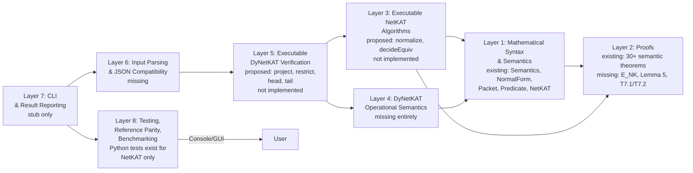

# Unified Architecture Requirements — DyNetKAT-Lean

**Task:** P3A — Planning task (documentation only)
**Date:** 2026-10-16
**Purpose:** Define the architectural requirements and boundaries needed to support BOTH a faithful Lean 4 formalization of the DyNetKAT calculus (including machine-checked proofs) AND a usable verification tool reproducing every confirmed capability of the reference DyNetiKAT implementation.

---

## 0. Paper-First Research Policy

This document establishes an explicit **Paper-First Research Policy** for the
DyNetKAT-Lean formalization project. This policy governs all design decisions,
definitions, and proofs in this repository and is non-negotiable.

### 0.1 Authoritative source

The **original DyNetKAT paper** is the sole authoritative source of mathematical
definitions and semantics for this formalization:

> *DyNetKAT: An Algebra of Dynamic Networks*,
> arXiv:2102.10035v4 (22 May 2021), FoSSaCS 2022.
> Source PDF: `DyNetKAT.pdf` at the repository root.

The paper's printed page numbers, equation numbers, and figure/table references
are authoritative. External sources cited by the paper (e.g., NetKAT [2],
process algebra [3], SDNRacer [30]) are background references only; the DyNetKAT
paper itself defines the semantics to be formalized.

### 0.2 Reference implementation role

The **DyNetiKAT reference tool** (`docs/DYNETIKAT_REFERENCE_AUDIT.md`,
`/Users/ali/Desktop/DyNetK` read-only) is a **functional compatibility reference**,
not a mathematical authority:

- DyNetiKAT is a Python+Maude orchestration tool that drives external solvers
  (Maude for equational rewriting; `katbv`/`netkat-automata` for NetKAT equivalence).
- It carries **no Lean-checked correctness guarantees** and uses external unverified
  backends.
- Its observable behavior (JSON input format, CLI interface, console output format)
  is reproduced as a **functional parity target**, not as a source of definitions.
- Where DyNetiKAT deviates from the paper, the paper wins.

### 0.3 Journal extension exclusion

The **journal extension** of DyNetKAT (log-based extraction, bounded schedules,
SDNRacer-specific causality analysis — see `docs/REUSE_AUDIT.md`) is a **separate
project**. It is **not** consulted for mathematical definitions in this formalization.
This is stated in `AGENTS.md` (§"Source of truth"):
> "The journal version (`DyNetKAT_Journal.pdf`) is NOT consulted for the calculus
> semantics."

This rule exists because the journal extension extends the calculus in directions
(log traces, bounded scheduling, external system coupling) that are outside the
scope of the original FoSSaCS 2022 formalization. All definitions, axioms, and
proofs must be traceable to the original paper alone.

### 0.4 Traceability requirement

Every mathematical definition, axiom, and proof in this repository must be:

- **Attributed** to a specific paper reference (definition number, theorem number,
  equation number, figure, and printed page).
- **Documented** in `docs/PAPER_CONFORMANCE.md` (the 31-item conformance map).
- **Traceable** from the Lean source to the paper via the conformance map.

Definitions or results that are **not** found in the paper must be explicitly
identified as **new results** — clearly distinguished from paper-derived material,
with a stated justification and a Research / Design Alarm entry
(`docs/DESIGN_ALARMS.md`).

### 0.5 Discrepancy handling

Any evidence that conflicts with a modeling or proof decision must raise a
**Research / Design Alarm** in `docs/DESIGN_ALARMS.md` and `HANDOFF.md`. Alarms
must be resolved — or explicitly accepted with justification — before the
conflicting work proceeds. Existing alarms (A1–A7) are preserved and must not be
silently overridden.

### 0.6 Semantic distinctions

The following mathematical concepts must remain **strictly distinct** throughout
this formalization and must not be conflated:

- **Semantic equivalence** (`⟦p⟧ = ⟦q⟧`): equality of denotational semantics
  (relational equality on `Packet × Packet`).
- **Equational derivability** (`E_DNK ⊢ p ≡ q`): syntactic derivation from axioms
  (inductive relation over axiom applications). Soundness (Theorem 1, part 1) and
  ground-completeness (Theorem 1, part 2) connect these, but they are distinct.
- **Bisimulation** (`p ∼ q`): coinductive labeled-transition relation
  (Definition 2, p. 11). Distinct from both semantic equivalence and derivability;
  Proposition 1 connects it to NetKAT semantics.
- **NetKAT⁻ᵈᵘᵖ vs. full NetKAT**: The paper's calculus uses NetKAT⁻ᵈᵘᵖ
  (dup-free fragment). The `dup` operator is excluded.

Conflating these concepts into a single "equivalence" notion is prohibited.

### 0.7 Mandatory objectives

Both of the following objectives are **mandatory** and cannot be traded off
against each other:

1. **Original proof objectives**: Every theorem listed in
   `docs/PROOF_OBLIGATIONS.md` (31 theorems across 9 tiers) must be formalized
   in Lean 4 and machine-checked, with no `sorry`, `admit`, or `axiom`
   substitutions. These include soundness (Theorem 1, part 1),
   ground-completeness (Theorem 1, part 2), bisimilarity congruence (Lemma 3),
   semantic layering (Proposition 1), normalization (Lemma 5, Lemma 9), and all
   safety framework definitions.

2. **Functional-parity requirements**: The executable verification tool must
   reproduce the documented capabilities of DyNetiKAT (JSON input parsing, CLI
   invocation, projection/restriction/head/tail pipeline, reachability and
   waypointing property checking) **without** depending on Maude, KATch, or
   external NetKAT solvers. Results must carry Lean-checked correctness
   guarantees connected to the formal semantics.

Neither objective subordinates the other: proofs are not sacrificed for
performance, and performance is not sacrificed for incomplete formalization.

### 0.8 Cross-references

This policy is reinforced by the following existing documents (preserved, not
duplicated):

- `AGENTS.md` — §"Source of truth" and §"Non-negotiable principles" establish
  the paper as authoritative and the journal extension as out of scope.
- `docs/PAPER_CONFORMANCE.md` — §0 scopes the paper only; the journal extension
  is explicitly excluded (line 8–9).
- `docs/DESIGN_ALARMS.md` — records all conflicts with modeling decisions;
  Alarm A7 documents the complete-assignment correction.
- `docs/REUSE_AUDIT.md` — confirms no components are directly reusable from the
  existing journal-extension repository.

---

## Executive Summary

This document specifies the architectural layers, interfaces, and constraints needed to build a single unified system that:

1. **Faithfully formalizes** the DyNetKAT calculus (arXiv:2102.10035v4 / FoSSaCS 2022) in Lean 4 with machine-checked proofs for all 31 theorems in `docs/PROOF_OBLIGATIONS.md`.
2. **Reproduces** the verifiable capabilities of the reference DyNetiKAT tool (`docs/DYNETIKAT_REFERENCE_AUDIT.md`) — JSON input parsing, CLI invocation, projection/restriction/head/tail pipeline, reachability & waypointing property checking — without depending on Maude, KATch, or external NetKAT solvers.

The architecture separates **semantic/computational concerns** across layers: mathematical definitions live in `Prop` (untrusted for computation but trusted for proof); executable algorithms produce results that are validated by Lean-checked correctness theorems. Noncomputable definitions are confined to the mathematical semantics layer; executable algorithms must either avoid classical choice or use explicit computable finite enumerations.

### Architectural layers (summary)

| # | Layer | Responsibility | Current status |
|---|---|---|---|
| 1 | Mathematical syntax & semantics | NetKAT syntax, packet model, denotational semantics | Implemented, builds |
| 2 | Equational derivability & proofs | E_DNK derivation relation, all 31 proof obligations | NetKAT semantic theorems proven; DyNetKAT axioms missing |
| 3 | Executable NetKAT algorithms | Normalization (Lemma 5), equivalence decision on normal forms | NormalForm representation defined; algorithm missing |
| 4 | DyNetKAT operational semantics | Process syntax (Fig. 5), configs (d,H,H'), labeled SOS (Fig. 8) | Missing |
| 5 | Executable DyNetKAT verification | Projection, restriction, head/tail, reachability, waypointing | Missing |
| 6 | Input parsing & JSON compatibility | Parse DyNetiKAT JSON input format, CLI args | Missing |
| 7 | CLI & result reporting | Command-line interface, console output matching DyNetiKAT | Missing (Main.lean is stub) |
| 8 | Testing, reference parity, benchmarking | Golden tests, benchmark harness, regression tests | Python tests exist for NetKAT only |

---

## 1. Mathematical syntax and semantics

### Responsibility

Defines the foundational mathematical objects of the DyNetKAT paper:

- **Packet model** (Definition 1, p. 5): `Packet (FieldType : Type) (Value : Type) := FieldType → Value` parameterized over finite field types.
- **NetKAT syntax** (Eq. 1, p. 6): `N ::= 0 | 1 | f=v | f←v | α | π | N+N | N;N | N*`.
- **Complete tests** (Definition 4, p. 8): total valuations, represented as `CompleteTest := CtxPkt`.
- **Complete assignments** (Definition 4, p. 8): total valuations, represented as `CompleteAssignmentValuation := CtxPkt`; the output of `σπ` equals π.
- **Denotational semantics** (Fig. 3, p. 5–6): `⟦N⟧ ⊆ Packet × Packet`, compositionally defined, with `StarClosure` for Kleene star as `⋃ₖ ⟦N⟧ᵏ`.
- **Predicate language** (Fig. 3): `Pr ::= 0 | 1 | f=v | Pr+Pr | Pr·Pr | ¬Pr`, with `eval : Predicate → CtxPkt → Bool`.

These definitions are the **trusted kernel**. They must be faithful to the paper and must not be weakened.

### Expected inputs

- None (foundational definitions).

### Expected outputs

- `Packet`, `FieldName`, `FieldValueEnum`, `CtxPkt` types with `Fintype` instances.
- `CompleteTest`, `CompleteAssignmentValuation`, `holdsComplete`, `applyValuation`.
- `Predicate` inductive with `eval`/`holds`.
- `NetKAT` inductive type (8 constructors: `drop`, `id`, `test`, `completeTest`, `assign1`, `union`, `seq`, `star`).
- `Semantics (N : NetKAT) : CtxPkt → CtxPkt → Prop`.
- `StarClosure` inductive type.

### Existing modules to reuse

- `packages/NetKATLean/NetKATLean/Core/Packet.lean` — packet model, `FieldName`/`FieldValueEnum`, `CompleteTest`, `CompleteAssignmentValuation`, `Fintype` instances (including `Fintype CtxPkt` from Task 2S).
- `packages/NetKATLean/NetKATLean/Core/AST.lean` — `Predicate` type, `NetKAT` inductive, `fieldEnum`, `completeAssignExpr`.
- `packages/NetKATLean/NetKATLean/Core/Semantics.lean` — `Semantics`, `StarClosure`, all proven semantic identities and algebra theorems.
- `packages/NetKATLean/NetKATLean/Core/NormalForm.lean` — `NormalForm` type, `interpret`, `ofSummand`, `interpret_sem`, `idNF_sem`, `testNF_sem`, `assign1NF_sem`, `unionNF_sem`, `seqNF_sem`, `mem_seqNF_iff`.

### Missing components

- **Lemma 5 normalization algorithm**: The normal form *representation* and *interpretation semantics* exist (`NormalForm.lean`), but the *algorithm* `G : NetKAT → NormalForm` that produces the normal form from any term is missing. Also missing is the proof `E_NK ⊢ p ≡ interpret(G(p))`.
- **Fintype for star termination**: While `Fintype CtxPkt` exists, no theorem proves that `StarClosure` stabilizes in finitely many steps on a finite domain.
- **E_NK axiomatization**: The NetKAT equational theory as an inductive `EDNK ⊢ p ≡ q` derivation relation is missing. (Semantic theorems exist; these are not equational derivations.)
- **Per-field value domains**: The paper uses `Vᵢ` (different value domain per field); current implementation uses a single `Value` type. This is a documented simplification.

### Correctness theorems connecting to semantics

- All theorems in `Semantics.lean` and `NormalForm.lean` connect definitions to the denotational semantics `⟦N⟧`.
- `interpret_sem` (Task 3C-2): `⟦interpret(nf)⟧(σ,τ) ↔ ∃ (α,π) ∈ nf, holdsComplete α σ ∧ τ = π` — this is the key bridge between normal forms and semantics.
- `idNF_sem`, `testNF_sem`, `assign1NF_sem`, `unionNF_sem`, `seqNF_sem` — each proves that a normal-form construction matches its NetKAT semantic counterpart.

---

## 2. Equational derivability and machine-checked proofs

### Responsibility

Establishes the equational theory `E_DNK` and proves the fundamental theorems:

- **NetKAT axiomatization E_NK** (cited from Anderson et al. [2]): Kleene algebra with tests axioms (Figure 4 of the DyNetKAT paper).
- **DyNetKAT axioms A0–A15 + AIP** (Fig. 11, p. 11): Deadlock sequencing, choice laws, parallel laws, left-merge, communication-merge, etc.
- **A16** (trace-equivalence, Definition 15): `p;(q ⊕ r) ≡ p;q ⊕ p;r`.
- **Derivability relation**: `E_DNK ⊢ p ≡ q` as an inductive relation (refl/trans/symm/subst + axioms).
- **Soundness** (Theorem 1, part 1): `E_DNK ⊢ p ≡ q ⟹ p ∼ q`.
- **Ground-completeness** (Theorem 1, part 2): `p ∼ q ⟹ E_DNK ⊢ p ≡ q` (for ground terms).
- **Normalization** (Lemma 9): `E_DNK` is normalizing for guarded DyNetKAT.

### Expected inputs

- All types and syntax from Layer 1.
- Extended DyNetKAT syntax from Layer 4 (the axiomatization operates on DyNetKAT terms).

### Expected outputs

- `AxEq : DyNetKAT → DyNetKAT → Prop` — single-step axiom application.
- `EDNK (p q : DyNetKAT) : Prop` — reflexive, symmetric, transitive, substitution-closed closure of `AxEq`.
- All 31 theorems from `docs/PROOF_OBLIGATIONS.md`.

### Existing modules to reuse

- `Semantics.lean` — semantic theorems (soundness is proved against these).
- `NormalForm.lean` — NormalForm type and interpretation (for normalization proofs).
- `AST.lean` — `NetKAT` syntax, predicate algebra lemmas in `Predicate` namespace.
- `Packet.lean` — packet algebra theorems (`Packet.ext`, update lemmas).

### Missing components

- **Derivability relation**: No `AxEq` or `EDNK` inductive type exists. The paper defines A0–A15 + AIP (Fig. 11); these must be formalized as a derivation relation, not just as semantic theorems.
- **A0–A15 inductive definition**: The 15 axioms (plus AIP) are documented in `DYNETIKAT_REFERENCE_AUDIT.md` Section 11.2 and `PAPER_CONFORMANCE.md` item 13 but have no Lean realization.
- **Soundness proofs (T5.1, T5.2)**: Individual NetKAT semantic identities are proven (Section 3.4 of FEATURE_GAP_ANALYSIS), but no full E_DNK soundness theorem exists.
- **Completeness proofs (T7.2)**: Ground-completeness requires normalization (Lemma 9) + summand matching; both missing.
- **AIP soundness (T5.2)**: Requires branching finiteness (Lemma 8) and sequence construction S_n.

### Correctness theorems connecting to semantics

- **T7.1** (Soundness): `EDNK p q → p ∼ q` (bisimilarity). Connects the derivability relation to the coinductive bisimulation.
- **T7.2** (Ground-completeness): `p ∼ q → EDNK p q` for ground terms. Connects bisimilarity back to derivability.
- All axiom soundness (T5.1): each of A0–A15 is sound w.r.t. bisimilarity.

---

## 3. Executable NetKAT algorithms

### Responsibility

Implements the NetKAT decision procedure that drives the verification pipeline. This replaces the external `katbv`/`netkat-automata` tools used by DyNetiKAT.

- **Normalization algorithm** `G : NetKAT → NormalForm` (Lemma 5): Given a NetKAT⁻ᵈᵘᵖ term, produce its normal form `Σ_{(α,π)∈A} α·π`.
- **Equivalence decision** on normal forms: Decide `p ≡ q` by checking whether `G(p) = G(q)` as finite sets (after accounting for summand ordering).
- **Star termination**: Determine when the reflexive-transitive closure `⟦N*⟧` has stabilized (bounded by `|CtxPkt|^2` steps on finite domains).

### Expected inputs

- `NetKAT` terms (from Layer 1).

### Expected outputs

- `NormalForm` (a `Finset (CompleteTest × CompleteAssignmentValuation)`).
- A decision procedure: `decideEquiv : NetKAT → NetKAT → Bool` (or `Prop` with a proof).

### Existing modules to reuse

- `NormalForm.lean` — the `NormalForm` type and `interpret` function define *what* a normal form is.
- `Packet.lean` — `fieldEnum`, `fieldEnum_complete`, `fieldEnum_nodup` enable computable enumeration of fields.
- `Semantics.lean` — `completeAssignExpr`, `completeTestEmbed` build NetKAT terms from normal-form components.

### Missing components

- **Normalization function `G`**: `NormalForm.lean` documents what a normal form is and proves semantic correspondence for *individual* constructions (`idNF`, `testNF`, `assign1NF`, `unionNF`, `seqNF`), but `G` itself — the function mapping an arbitrary `NetKAT` term to its normal form — is not implemented.
- **Correctness of `G`** (Lemma 5): `E_NK ⊢ p ≡ interpret(G(p))`.
- **Equivalence decision**: No algorithm decides `⟦p⟧ = ⟦q⟧` by normalizing both sides.
- **Computable enumeration**: `NormalForm.lean` uses `noncomputable` on `summandsToList` (via `Finset.toList`), `interpret` (depends on `summandsToList`), `testNF` (via `Finset.filter`), `unionNF` (via `Finset.union` requiring `DecidableEq`), `assign1NF` (marked for consistency), and `seqNF` (via `Finset.product`/`filter`/`image`). However, `idNF` and `ofSummand` are **computable** — `idNF` uses `Finset.univ.map` with an explicit embedding (which does not require `DecidableEq` on the codomain), and `ofSummand` uses only pattern matching. The executable algorithm must either:
  - Use `fieldEnum` (computable list of all fields) to enumerate `CompleteTest`/`CompleteAssignmentValuation` values computably, or
  - Establish a `Computable`/`Decidable` path for the finite types so `Finset` operations can execute.

### Correctness theorems connecting to semantics

- **Lemma 5** (T1.4): `∀ p : NetKAT, ∃ q = interpret(G(p)), E_NK ⊢ p ≡ q`.
- **Completeness of normalization**: `⟦p⟧ = ⟦interpret(G(p))⟧` (semantic equivalence between term and its normal form).

---

## 4. DyNetKAT operational semantics and process reasoning

### Responsibility

Defines DyNetKAT process syntax (Fig. 5), multi-packet configurations, and the labeled small-step SOS (Fig. 8). This is the foundation for all DyNetKAT-specific reasoning (bisimulation, axioms, safety).

- **DyNetKAT syntax** (Eq. 6, p. 14): `D ::= ⊥ | N;D | x?N;D | x!N;D | rcfg(x,N);D | D‖D | D⊕D | δ_ℒ(D) | π_n(D) | D⌊⌊D | D|D|D | X`.
- **Channel type**: A countably infinite set of channel names.
- **Recursive variables**: `X` with uniquely defined `X ≜ D` (guarded recursion per Definition 7).
- **Configurations** `(d, H, H')` (Fig. 5, p. 8): `d : DyNetKAT`, `H : List Packet` (pending), `H' : List Packet` (handled).
- **Labels** (Fig. 8, p. 9): `γ ::= (σ,σ') | x?r | x!r | rcfg(x,r)`.
- **Small-step labeled transition** `Step : Config → Action → Config → Prop` (Fig. 8): `cpol_;✓`, `cpol_;✗`, `cpol_⊕`, `cpol_‖`, `cpol_recv`, `cpol_send`, `cpol_sync`.

### Expected inputs

- Layer 1: `NetKAT`, `Packet`, `Semantics`, `Predicate`, `CompleteTest`, `CompleteAssignmentValuation`.
- `Channel` type (countably infinite).

### Expected outputs

- `inductive DyNetKAT` (extended syntax with ⊥, ;, x?N, x!N, rcfg, ‖, ⊕, δ, π, ⌊⌊, | |, X).
- `inductive Action` (packet flow, recv, send, rcfg).
- `structure Config` (proc, pending, handled).
- `inductive Step : Config → Action → Config → Prop` with all transition rules from Fig. 8.

### Existing modules to reuse

- `packages/NetKATLean/NetKATLean/Core/Packet.lean` — `CtxPkt`, `Packet.update`, `Fintype` instances.
- `packages/NetKATLean/NetKATLean/Core/AST.lean` — `NetKAT`, `Predicate`, `fieldEnum`, `completeAssignExpr` (NetKAT⁻ᵈᵘᵖ is a sub-syntax of DyNetKAT).
- `packages/NetKATLean/NetKATLean/Core/Semantics.lean` — `Semantics` used by the `cpol_;✓` rule.

### Missing components

- **No DyNetKAT directory exists**: No `lean/DyNetKAT/DyNetKAT/` directory exists (per FEATURE_GAP_ANALYSIS.md Section 4). The proposed structure in `ARCHITECTURE.md` (lines 19–24) is aspirational, not implemented.
- **Extended operators**: δ, π, rcfg, ⌊⌊, | | — none defined.
- **Bisimulation**: Coinductive Definition 2, Lemma 3 (congruence), Proposition 1 (semantic layering) — all missing.

### Correctness theorems connecting to semantics

- **T2.2**: Operational semantics well-defined (inductive definition of `Step`).
- **T2.3** (Per-packet consistency): Design invariant — each packet processed by exactly one process term.
- **T4.3** (Semantic layering): `⟦p⟧ = ⟦q⟧ ↔ (p;d) ∼ (q;d)` — connects NetKAT denotational semantics to DyNetKAT bisimilarity.

---

## 5. Executable DyNetKAT verification algorithms

### Responsibility

Implements the analysis pipeline that DyNetiKAT reproduces: projection → restriction → head/tail extraction → NetKAT equivalence decision. This layer is the executable engine that the CLI drives.

- **Projection** `π_n(D)` (Eq. 3, p. 9): Unfolds recursive variables to depth `n`. Defined as `pi_0(P) = bot`, `pi_{n+1}(at;p) = at;pi_n(p)`.
- **Restriction** `δ_ℒ(D)` (Eq. 2, p. 8): Filters transitions whose labels are in `ℒ` (the encapsulation set of all `x!r` and `x?r` terms).
- **head(D)** (paper p. 969–985, `dnk.maude:130-131`): Extracts the leading NetKAT policy from a DyNetKAT term: `head(bot) = zero`, `head(Z;D) = Z + head(D)`, etc.
- **tail(D, RSet)** (paper p. 969–985, `dnk.maude:132, 145-149`): Extracts post-synchronization policy.
- **Reachability checking** (`r` property type): `in . (p.t)* . out != 0` (reachable) or `== 0` (unreachable).
- **Waypointing checking** (`w` property type): Verifies all paths from `in` to `out` pass through `wp`.

### Expected inputs

- DyNetKAT program (from Layer 4 syntax).
- Channel set `channels : List String`.
- Ingress/egress packet predicates (`in_packets`, `out_packets` from JSON).
- Properties (list of `[type, expression, expected, unfoldings]`).

### Expected outputs

- For each (packet, property) pair: `satisfied`, `violated`, or `error`.
- Timing breakdown (if `-s` flag): total time, preprocessing time, NetKAT decision time.
- Console output matching DyNetiKAT format (Section 8.1 of reference audit).

### Existing modules to reuse

- Layer 3: `NormalForm.interpret`, `SeqNF` (relational composition on normal forms).
- Layer 1: `Semantics`, `StarClosure` (for reachability semantics).
- Layer 4: `Step` relation (transition semantics for projection/restriction).

### Missing components

- **No executable pipeline exists**: `Main.lean` is a stub that prints a project name string. No projection, restriction, head, tail, or property-checking logic.
- **No equivalence decision procedure**: Layer 3's `decideEquiv` is also missing; both layers depend on it.
- **head/tail operators**: No functions exist to extract NetKAT policies from DyNetKAT terms.
- **Reachability/waypointing encoding**: No encoding of the reference tool's property-checking formulas (Section 5.2, 5.3 of reference audit).

### Correctness theorems connecting to semantics

- **T3.1**: Restriction `δ_ℒ(−)` is sound: preserves bisimilarity.
- **T3.2**: Projection `π_n(−)` is well-defined; `π_n(p)` captures exactly the first `n` transitions.
- **AIP soundness** (T5.2): `p = q` if `∀ n: π_n(p) = π_n(q)` — this is the theorem that justifies bounded unfolding as an analysis technique.

### Interface to Layer 2 (derivability)

The verification pipeline must produce results that are correct w.r.t. the equational theory:

- A "property satisfied" result requires a proof (constructible in Lean) that `EDNK^tr ⊢ [prop]`.
- A "property violated" result requires either a proof or a counterexample (packet) showing the negation.

Design constraint: The executable pipeline produces `Bool` results; the correctness theorem (in Layer 2) establishes `result = "satisfied" → E_DNK^tr ⊢ [prop]`.

---

## 6. Input parsing and JSON compatibility

### Responsibility

Provides parsing of the DyNetiKAT JSON input format and CLI arguments, so that the verification tool can reproduce DyNetiKAT's documented behavior.

- **JSON schema** (from `DYNETIKAT_REFERENCE_AUDIT.md` Section 3): Keys `module_name`, `recursive_variables`, `program`, `channels`, `in_packets`, `out_packets`, `properties`.
- **Property format**: Each property is a 4-element list `[type, expression, expected, unfoldings]`.
- **CLI argument parsing** (from `dnk.py:20-32`): `python3 dnk.py <path_to_maude> <path_to_netkat_tool> <input_file> [options]`.
- **CLI options** (from `dnk.py:24-31`): `-t/--threads`, `-p/--preprocessed`, `-v/--netkat-version`, `-s/--time-stats`.

### Expected inputs

- JSON file path.
- CLI arguments (program name + options).

### Expected outputs

- Parsed representation: `module_name`, `recursive_variables`, `program` (DyNetKAT syntax), `channels`, `in_packets`, `out_packets`, `properties`.
- Parsed CLI options record.

### Existing modules to reuse

- **None directly**: The current `DyNetKAT.lean` imports only NetKAT modules. No JSON parser or CLI option parser exists.
- `DyNetKAT/Main.lean` — stub entry point, no parsing.

### Missing components

- **JSON schema definition**: No formal schema exists. Must match the DyNetiKAT reference (Section 3 of reference audit).
- **JSON-to-DyNetKAT parser**: Must parse the `program` string into the `DyNetKAT` inductive type. This is a string-to-AST parser for both NetKAT (within DyNetKAT policies) and DyNetKAT process syntax.
- **DyNetKAT string parser**: The paper's notation (Fig. 5) must be parseable. The reference tool uses Maude's parser; we need our own.
- **CLI argument parser**: No argument parsing exists in `Main.lean`.

### Correctness theorems connecting to semantics

- There are no mathematical correctness theorems for parsing itself (parsing is not a semantic concern). However:
- The **soundness** of parsed terms: if a program parses to DyNetKAT term `d`, then `d` must be well-formed (guarded recursion, etc.).
- JSON compatibility: the parsed representation must round-trip with the reference tool's expectations for interoperability testing.

### Design decisions for JSON compatibility

The reference DyNetiKAT uses specific encodings (from `DYNETIKAT_REFERENCE_AUDIT.md` Section 4):

| Paper notation | Tool encoding |
|---|---|
| `0` (drop) | `zero` |
| `1` (identity) | `one` |
| `f = n` | `f = n` |
| `f <- n` | `f <- n` |
| `~` | `~` |
| `bot` | `bot` |
| `N ; D` | `arg1 ; arg2` |
| `x ! N` | `arg1 ! arg2` |
| `x ? N` | `arg1 ? arg2` |
| `D || D` | `arg1 || arg2` |
| `D o+ D` | `arg1 o+ arg2` |
| `rcfg(x, N)` | `rcfg(arg1, arg2)` |

Our parser must accept these encodings to reproduce reference behavior. The internal AST uses paper notation (⊥, ⊕, ‖), so a translation layer is needed between the JSON encoding and the Lean AST.

---

## 7. CLI and result reporting

### Responsibility

Provides the command-line interface and output formatting that matches the DyNetiKAT reference tool.

- **Console output** (from `dnk.py:86-100`):
  - `Packet: {packet} - property: #{prop_num}: property satisfied.`
  - `Packet: {packet} - property: #{prop_num}: property violated.`
  - `Packet: {packet} - property: #{prop_num}: an error occurred while checking this property.`
- **Timing output** (from `dnk.py:96-100`, with `-s` flag):
  - `Total time: X.XX seconds`
  - `Preprocessing time: X.XX seconds`
  - `NetKAT time: X.XX seconds`
- **Output files** (from `dnk.py:63-67`): Writes `{module_name}_preprocessed.json` with serialized `comm` set.

### Expected inputs

- Parsed JSON input (from Layer 6).
- Parsed CLI options (from Layer 6).
- Analysis results (from Layer 5).

### Expected outputs

- Console output matching DyNetiKAT format.
- Result classification: `satisfied`, `violated`, `error`.
- Optional timing output.
- Optional preprocessed JSON output file.

### Existing modules to reuse

- **None for CLI**: `Main.lean` is a 4-line stub. No output formatting, no option parsing.

### Missing components

- **All CLI functionality**: `Main.lean` needs complete rewrite to accept arguments, parse input, invoke the analysis pipeline, and format output.
- **Result classification logic**: Logic to map analysis results to `satisfied`/`violated`/`error` per the reference tool's rules (Section 5.4 of reference audit).
- **Timing instrumentation**: Time tracking for total, preprocessing, and NetKAT decision phases.
- **JSON output writer**: Writes preprocessed JSON (if not pre-skiped via `-p` flag).

### Correctness theorems connecting to semantics

- The CLI output must be a faithful reproduction. No mathematical theorems connect to the CLI, but **functional parity** is required: given the same input, our tool must produce the same classification (`satisfied`/`violated`/`error`) as DyNetiKAT.

### Note on dependency removal

The reference CLI requires `<path_to_maude>` and `<path_to_netkat_tool>` as positional arguments. Our tool does **not** need these — we replace both external solvers with internal Lean algorithms. The CLI signatures will differ: our tool takes only `<input_file> [options]`.

---

## 8. Testing, reference parity, and benchmarking

### Responsibility

Ensures the implementation maintains parity with the reference DyNetiKAT tool and provides regression coverage.

- **Golden tests**: Python tests mirroring NetKAT semantics (currently 16 tests in `python/tests/test_netkat.py`).
- **Reference regression tests**: Run the same inputs through both our tool and DyNetiKAT; compare results.
- **Benchmark harness**: Reproduce FatTree, stateful firewall, and distributed controller benchmarks (Section 9 of reference audit).
- **Property-based testing**: For each normal-form construction, verify semantic correspondence on concrete inputs.

### Expected inputs

- Test inputs: small NetKAT/DyNetKAT programs, reference benchmark JSON files.
- Reference tool outputs (for parity comparison).

### Expected outputs

- Pass/fail status for each test.
- Benchmark timing reports.
- Parity report: which reference capabilities are reproduced.

### Existing modules to reuse

- `python/tests/test_netkat.py` — 16 golden tests for NetKAT semantics (packet model, complete tests, NetKAT semantics, concrete examples).
- `scripts/verify.sh` — combined Lean build + Python test runner.
- `packages/NetKATLean/NetKATLean/Core/NormalForm.lean` — semantic theorems for `interpret_sem`, `idNF_sem`, `testNF_sem`, etc.

### Missing components

- **DyNetKAT-level tests**: No tests for DyNetKAT syntax, operational semantics, or verification pipeline. Only NetKAT-level tests exist.
- **Reference parity tests**: No test harness comparing our tool's output against DyNetiKAT's output on the same inputs.
- **Benchmark harness**: No FatTree generation, stateful firewall encoding, or distributed controller encoding tests.
- **CLI tests**: No tests for CLI argument parsing, JSON parsing, or output formatting.

### Correctness theorems connecting to semantics

- Golden tests verify *concrete* semantic instances (e.g., `⟦tp_src=8⟧` on specific packets).
- Regression tests verify that semantic correspondence theorems (`interpret_sem`, `idNF_sem`, etc.) hold for concrete inputs.
- Reference parity tests verify functional equivalence with DyNetiKAT (a tool-level property, not a mathematical theorem).

### Test inventory from reference audit

| Benchmark | Reference source | Our status |
|---|---|---|
| Stateful firewall | `benchmarks/stateful_firewall.json` | Missing (only Python NetKAT example exists) |
| Distributed controller (independent) | `benchmarks/distributed_controller_independent.json` | Missing |
| Distributed controller (synchronized) | `benchmarks/distributed_controller_synchronized.json` | Missing |
| FatTree (pods 6–16) | `benchmarks/fattree_*.json` | Missing |

---

## Critical design constraints

### Constraint 1: Noncomputable mathematical definitions vs. executable algorithms

**Question:** How will noncomputable mathematical definitions relate to executable algorithms?

**Analysis:**

The current codebase uses `noncomputable` in several places:

- `NormalForm.lean`: `summandsToList` (uses `Finset.toList` — noncomputable, relies on classical choice for set-to-list conversion), `interpret` (noncomputable, depends on `summandsToList`), `testNF` (noncomputable, uses `Finset.filter` requiring classical `DecidablePred`), `assign1NF` (noncomputable, marked for consistency despite having a computable `DecidableEq` path), `unionNF` (noncomputable, uses `Finset.union` requiring `DecidableEq`), `seqNF` (noncomputable, uses `Finset.product`/`filter`/`image` requiring `DecidableEq`).
  - **Computable exception:** `idNF` — uses the same `Finset.univ.map` pattern as `assign1NF` but is declared as a plain `def` (computable) because `Finset.map` with an explicit embedding does not require `DecidableEq` on the codomain.
  - **Note on `DecidableEq`:** `unionNF`, `seqNF`, and `assign1NF` obtain `DecidableEq (FieldName → FieldValueEnum)` via `inferInstance` (computable, since `FieldName` and `FieldValueEnum` both derive `DecidableEq`). The `noncomputable` marker is applied defensively/consistently rather than out of mathematical necessity. Only `summandsToList` (via `Finset.toList`) and `testNF` (via `Finset.filter`) are genuinely noncomputable due to classical choice.
- `Packet.lean`: Theorems like `holdsComplete_iff_eq` use `funext_iff` and classical reasoning.
- `Semantics.lean`: `StarClosure` is an inductive type (computable in principle, but no termination bound proven).

**Design decision:** Separate **mathematical semantics** (in `Prop`, may use classical logic) from **executable algorithms** (must be computable). The pattern is:

1. **Semantic definitions** (`Semantics`, `StarClosure`, `NormalForm.interpret`) live in `Prop` or use noncomputable operations. They are trusted for *proof*.
2. **Executable algorithms** (`normalize`, `decideEquiv`, `project`, `restrict`) must be computable. They use:
   - `fieldEnum` (computable `List FieldName`) instead of `Finset.univ.toList`.
   - Explicit case analysis on `NetKAT` constructors instead of classical reasoning.
   - Computable `Decidable` instances where available (e.g., `FieldName` and `FieldValueEnum` derive `DecidableEq`).
3. **Correctness bridge**: Theorems connecting the executable algorithm's output to the semantic definition. For example:
   - `normalize_correct: ∀ p, ⟦p⟧ = ⟦interpret(normalize p)⟧` (normalization preserves semantics).
   - `decideEquiv_sound: decideEquiv p q = true → ⟦p⟧ = ⟦q⟧`.
   - `decideEquiv_complete: ⟦p⟧ = ⟦q⟧ → decideEquiv p q = true` (completeness requires finite domains).

**Evaluation criteria:** An algorithm is executable if it has no `noncomputable` declarations in its dependency chain and uses only computable `Decidable` instances. The `fieldEnum` + explicit enumeration approach achieves this for the concrete 4×4 packet domain.

### Constraint 2: Executable verification results obtaining Lean-checked correctness guarantees

**Question:** How will executable verification results obtain Lean-checked correctness guarantees?

**Analysis:**

The reference DyNetiKAT tool produces *unverified* results (Python orchestrates Maude + NetKAT tools). Our architecture must produce results that are *verified* by Lean. Two approaches:

**Approach A — Extract/Lemmas**: The executable algorithm runs in Lean (computable), and its correctness is established by a theorem `algorithm_correct : result = true → property_holds`. The algorithm's result is only trusted after the theorem is checked.

**Approach B — Reflection**: Define the algorithm as a Lean function, prove it correct by reflection (the algorithm *is* the proof witness). This is the idiomatic Lean approach for decision procedures.

**Design decision:** Use a hybrid:

1. **NetKAT equivalence** (Layer 3): The `decideEquiv` algorithm normalizes both terms and checks Finset equality. The correctness theorem `decideEquiv_sound` and (with finite domains) `decideEquiv_complete` are proven in Layer 2. When the algorithm returns `true`, the Lean kernel has already checked the proof of correctness.

2. **DyNetKAT verification** (Layer 5): The analysis pipeline (`π_n`, `δ_ℋ`, `head`, `tail`) runs as Lean code. Each step has a correctness theorem:
   - `project_correct`: The result of `π_n(D)` has the correct bounded semantics.
   - `restrict_sound`: `δ_ℋ(D)` eliminates exactly the communication actions in `ℋ`.
   - `head_correct`: `head(D)` produces the NetKAT policy representing the current configuration.
   - `tail_correct`: `tail(D, RSet)` produces the post-synchronization policy.
   - `reachability_sound`: If the pipeline reports "reachable", then `in · (p·t)* · out ≠ 0`.
   - `reachability_complete`: If `in · (p·t)* · out ≠ 0`, then the pipeline reports "reachable" (on finite domains with sufficient unfolding bound).

3. **Result validation**: The CLI does not just print "satisfied"; it constructs (or has constructed elsewhere) a proof term `E_DNK^tr ⊢ ⟦prop⟧ ⊕ i ≡ ⟦prop⟧`. The `true/false` result carries a proof certificate that the kernel checks.

**Evaluation criteria:** Every `result = "satisfied"` must come with a machine-checked proof (or computable proof that is checked). `result = "violated"` may come with a counterexample (a concrete packet) that the kernel verifies.

### Constraint 3: Packet schemas larger than four fields

**Question:** How will we support packet schemas larger than the current four-field model?

**Analysis:**

The current implementation uses a concrete `FieldName` (4 constructors) and `FieldValueEnum` (4 constructors). The paper's model is parameterized: "Let F = {f₁,...,fₙ} be a set of field names with values in Vᵢ."

**Design decision:** The `Packet` type is already parameterized (`Packet (FieldType : Type) (Value : Type) := FieldType → Value`), but the concrete modules (`AST.lean`, `Semantics.lean`, `NormalForm.lean`) are hardcoded to `CtxPkt = Packet FieldName FieldValueEnum`.

To support larger schemas:

1. **Parameterize the executable algorithms** over `FieldType` and `Value` types with `[Fintype FieldType]` and `[Fintype Value]` instances, plus `[DecidableEq FieldType]`.
2. **Computable field enumeration**: The `fieldEnum : List FieldName` approach is hardcoded to 4 fields. For a general `FieldType`, we need `(Finset.univ : Finset FieldType).toList` — but this is `noncomputable`. To make it computable:
   - Require `[Fintype FieldType]` to provide a `Finset.univ`.
   - Use a `Computable` enumeration function that works when `FieldType` is concrete (inductive with a known number of constructors).
   - For the 4×4 case, `fieldEnum` is an explicit list (computable). For larger schemas, the enumeration must be generated from the `Fintype` instance or a user-provided list.
3. **Dynamic packet construction**: The verification tool reads `in_packets` and `out_packets` from JSON. These specify field=value predicates. The tool must construct the corresponding `CompleteTest`/`Predicate` from the concrete field names and values.

**Evaluation criteria:** Given a JSON input with N fields and M values per field, the tool must:
- Construct a packet type `FieldName → FieldValue` with N field names and M values.
- Enumerate all `M^N` packets (for small N, M).
- Compute normal forms via `fieldEnum` enumeration.

The 4×4 model is a test fixture; the general case requires the parameterized types to be used throughout.

### Constraint 4: Avoiding enumeration of enormous packet spaces

**Question:** How will the backend avoid enumerating enormous packet spaces where symbolic representations are needed?

**Analysis:**

The current normal-form representation uses `Fintype CtxPkt`, which for the 4×4 model has `4^4 = 256` packets. For a realistic network (e.g., 14 fields with 256 values each), this is `256^14 ≈ 10^34` packets — impossible to enumerate.

**Design decision:** Use **symbolic normal forms** instead of enumeration:

1. **Normal forms as symbolic sums**: A normal form `Σ_{(α,π)∈A} α·π` is a finite set of summands. Each summand `(α, π)` is a pair of total valuations, represented symbolically (not as an enumerated packet). The set `A` is typically small due to NetKAT's structure (it is the language model `G(p)` from Lemma 5).

2. **Symbolic evaluation, not enumeration**: The equivalence decision procedure compares normal forms by comparing their `Finset` representations directly (`A = B` as finite sets), not by evaluating `⟦N⟧` on every packet. This is the standard NetKAT approach — Lemma 5 shows every term has a normal form, and equivalence reduces to normal-form equality.

3. **head/tail as symbolic extraction**: The `head` operator extracts the *leading NetKAT policy* from a DyNetKAT term — this is a syntactic transformation, not a packet enumeration. Similarly, `tail` extracts the continuation after synchronization.

4. **Finite-domain assumption is for star termination, not for enumeration**: The paper's finiteness assumption ensures `⟦N*⟧ = ⋃ₖ ⟦N⟧ᵏ` terminates. But the *implementation* uses normal-form decomposition, not star unfolding, for equivalence checking. The normal-form construction itself is structural (Lemma 5 proof), not enumeration-based.

**Evaluation criteria:** The verification tool must never enumerate all packets. It should work with symbolic normal forms (finite sets of summands). Enumeration is only used for: (a) small test fixtures, (b) counterexample generation when a property is violated.

### Constraint 5: Bounded unfolding vs. unbounded mathematical guarantees

**Question:** How will we distinguish bounded unfolding results from unbounded mathematical guarantees?

**Analysis:**

The reference DyNetiKAT tool uses `π_n` (projection to depth `n`) with a user-specified bound. The Approximation Induction Principle (AIP) states that `p = q` if `∀ n: π_n(p) = π_n(q)`, but this is a meta-principle — the tool checks up to a finite `n`.

**Design decision:** Maintain a strict distinction in the type system and output:

1. **Bounded results are typed differently**: `checkBounded (n : ℕ) (prop)` returns `BoundedResult` (satisfied/violated/unknown-within-bound). `checkUnbounded (prop)` returns `UnboundedResult` (satisfied/violation-found).

2. **The AIP theorem** (T5.2) is a mathematical proof that connects bounded to unbounded: `∀ n: π_n(p) = π_n(q) → p ∼ q`. This is a proof in Layer 2, not an executable algorithm.

3. **CLI output distinguishes**: The reference tool prints `property satisfied` for bounded results. We should print `property satisfied (bounded, n=N)` or `property satisfied (unbounded)` to make the distinction clear. The reference tool's format can be matched for `satisfied`/`violated`/`error`, but additional metadata should indicate boundedness.

4. **Counterexample soundness**: If the bounded check says "violated" (i.e., it found a counterexample within bound `n`), this is an *unbounded* guarantee — the counterexample is a concrete packet/trace that witnesses the violation, verifiable by the kernel regardless of the bound.

**Evaluation criteria:** Every result must carry a proof level: `bounded_satisfied` (may not hold unboundedly), `violated` (hard counterexample), or `unbounded_satisfied` (proven via AIP or structural argument).

### Constraint 6: Reproducing DyNetiKAT's JSON and CLI behavior without copying its backend

**Question:** How will we reproduce DyNetiKAT's documented JSON and CLI behavior without copying its backend?

**Analysis:**

The reference tool's input format (JSON) and output format (console) are *specified* in `DYNETIKAT_REFERENCE_AUDIT.md` Sections 3, 8. We reproduce these *interfaces* without using Maude or NetKAT tools.

**Design decision:**

1. **Input compatibility**: Our JSON parser (Layer 6) accepts the exact schema from the reference audit. The `program` string is parsed by our own parser (not Maude). The DyNetKAT expression syntax in JSON uses the tool's encoding (`zero`, `one`, `bot`, `;`, `!`, `?`, `||`, `o+`, `rcfg(...)`), which maps to our AST constructors.

2. **Output compatibility**: Our CLI (Layer 7) produces the exact console format from `dnk.py:86-100`. Timing output uses `-s` flag. The classification logic (satisfied/violated/error) matches `dynetkat.py:97-122`.

3. **No backend copying**: We do NOT replicate Maude's equational rewriting or the NetKAT decision procedure. Instead:
   - Our normalization algorithm (Layer 3) replaces Maude's axiom application.
   - Our equivalence checker (Layer 3) replaces `katbv`/`netkat-automata`.
   - Our projection/restriction (Layer 5) replaces the Maude `pi` and `delta` operators.

4. **Preprocessing difference**: The reference tool's preprocessing step (Section 5.1 of audit) extracts NetKAT sub-terms, checks them for equivalence to `zero`, and zeroes out dead branches. In our architecture, this is *not* a preprocessing step but a *structural* part of normalization — the normalization algorithm naturally produces zero for drop-only branches. The JSON output of preprocessing (for `-p`/non-preprocessed mode) should match the reference format for interoperability.

**Evaluation criteria:** Given the same JSON input, our tool must classify each property as `satisfied`/`violated`/`error` identically to DyNetiKAT. The intermediate representations differ (our normal forms vs. their Maude terms + NetKAT terms), but the final classification must match.

---

## Preservation and integration

### Existing mathematical components that must remain unchanged

The following components are verified (build passes, all theorems proven, no proof holes) and **must not be modified** in their meaning:

**Packet.lean:**
- `Packet` (line 36)
- `get`, `update`, `ext`, `get_update_same`, `get_update_diff`, `update_id`, `update_update_same`, `update_update_diff` (lines 41-53) with update lemmas
- `FieldName` inductive (4 constructors, lines 117-123), `Fintype FieldName` instance
- `FieldValueEnum` inductive (4 constructors, lines 132-138), `Fintype FieldValueEnum` instance
- `Fintype CtxPkt` instance (lines 158-161, Task 2S)
- `CompleteTest`, `holdsComplete` (lines 193-205)
- `holdsComplete_iff_eq` (line 218, Task 3D-1)
- `CompleteAssignmentValuation`, `applyValuation` (lines 253-269)
- `applyValuation_field` (line 277)

**AST.lean:**
- `Predicate` inductive (6 constructors, lines 37-44)
- `Predicate.eval`, `Predicate.holds` (lines 49-59)
- Predicate Boolean algebra lemmas (lines 205-229)
- `NetKAT` inductive (8 constructors, lines 89-97)
- `fieldTest`, `completeTestEmbed`, `completeAssignExpr`, `plus` (lines 124-150)
- `fieldEnum_complete`, `fieldEnum_nodup` (lines 150-156)
- `NetKAT.size` (lines 166-174)

**Semantics.lean:**
- `StarClosure` inductive (line 51)
- `Semantics` (8 clauses, lines 61-71)
- `eval` (line 74)
- `drop_empty`, `id_diag`, `union_sem`, `seq_sem` (lines 82-102)
- `seq_deterministic_sem` (line 114)
- `star_refl`, `star_step` (lines 140-147)
- `fieldTest_sem`, `notTest_sem`, `orTest_sem`, `andTest_sem` (lines 156-243)
- `completeTest_sem` (line 252)
- `assign1_sem`, `assign1_seq_sem` (lines 263-295)
- `assign_list_sem` (line 311)
- `id_reflexive`, `drop_no_output` (lines 343-349)
- `union_eval`, `drop_eval_empty`, `id_eval_diag` (lines 360-387)
- `seq_id_left`, `seq_id_right`, `seq_drop_left`, `seq_drop_right` (lines 390-433)
- `union_assoc`, `union_comm`, `union_idem`, `seq_distrib_left`, `seq_distrib_right` (lines 436-490)
- `pred_excluded_middle`, `pred_contra`, `pred_double_neg`, `pred_deMorgan_or`, `pred_deMorgan_and` (lines 498-550)
- `assign_overwrite`, `assign_comm_diff`, `assign_test_same_field`, `test_assign_same_field` (lines 558-588)
- `fieldEnum_updates_complete`, `completeAssignExpr_sem` (lines 595-655)

**NormalForm.lean** (untracked!):
- `NormalForm` type, `empty`, `ofSummand`, `summandsToList`, `interpret` (lines 60-114)
- `ofSummand_sem`, `fold_sem`, `interpret_sem`, `emptyNF_sem` (lines 138-347)
- `idNF`, `idNF_sem`, `testNF`, `testNF_sem` (lines 371-478)
- `unionNF`, `unionNF_sem` (lines 558-686)
- `assign1NF`, `assign1NF_sem` (lines 592-624)
- `seqNF`, `mem_seqNF_iff`, `seqNF_sem` (lines 755-883)

### Git checkpoint issue

`NormalForm.lean` is **untracked** in git but is imported by `DyNetKAT.lean` (line 8: `import NetKATLean.Core.NormalForm`). The build succeeds because Lake resolves it from the working tree, but:
- Any clone of the repo without committing this file will fail to build.
- The file contains substantial verified work (NormalForm type, 10+ theorems).
- Per task instructions: Do not delete, stage, or commit it in this task. Record this as a checkpoint issue in HANDOFF.md.

### New interfaces needed between proof code and executable algorithms

1. `normalize` (Layer 1 -> Layer 3) — produces normal form from a NetKAT term.
2. `normalize_correct` (Layer 1+2 -> Layer 3) — proves normalization preserves semantics.
3. `decideEquiv` (Layer 1 -> Layer 3) — decides NetKAT equivalence via normal forms.
4. `decideEquiv_sound` (Layer 3 -> Layer 2) — soundness of equivalence decision.
5. `decideEquiv_complete` (Layer 1 -> Layer 3) — completeness (finite domains).
6. `project` (Layer 4 -> Layer 5) — bounded unfolding.
7. `project_correct` (Layer 5 -> Layer 2) — bounded semantics of projection.
8. `restrict` (Layer 4 -> Layer 5) — restriction operator.
9. `restrict_sound` (Layer 5 -> Layer 2) — soundness of restriction.
10. `head` (Layer 4 -> Layer 5) — current configuration extraction.
11. `head_correct` (Layer 5 -> Layer 2) — correctness of head extraction.
12. `tail` (Layer 4 -> Layer 5) — post-synchronization extraction.
13. `tail_correct` (Layer 5 -> Layer 2) — correctness of tail extraction.

### Correctness obligations for those interfaces

Each interface must satisfy:
1. **Soundness**: If the executable algorithm returns /satisfied, there exists a Lean-checked proof that the property holds (semantically).
2. **Completeness (finite domains)**: If the property holds (semantically), the algorithm returns /satisfied — provided the packet domain is finite and the unfolding bound is sufficient.
3. **Counterexample soundness**: If the algorithm returns /violated, it produces a concrete counterexample (packet, trace) that can be verified by Lean in constant time.

### Potential conflicts between functional parity and formal verification

| Conflict | Description | Mitigation |
|---|---|---|
| Bounded vs. unbounded | DyNetiKAT uses bounded pi_n; we may prove unbounded results. | Distinguish result types: BoundedResult vs. UnboundedResult. Report boundedness metadata in output. |
| Noncomputable vs. executable | NormalForm.lean uses noncomputable; the decision procedure must execute. | Keep mathematical NormalForm.interpret noncomputable for proof; provide separate computable normalize function for execution, connected by normalize_correct. |
| External solver results | DyNetiKAT delegates to katbv; we must prove equivalence internally. | decideEquiv_complete theorem provides the bridge: normalization + Finset equality IS the decision procedure, with a proof. |
| Maude rewriting vs. derivability | DyNetiKAT uses Maude rewriting; we use E_DNK derivability. | Soundness and completeness of E_DNK (T7.1, T7.2) ensure equivalence. |
| JSON encoding differences | DyNetiKAT uses zero/one/o+ notation; our AST uses drop/id/union. | Deterministic parser maps JSON encoding to Lean AST constructors. Round-trip tests ensure fidelity. |
| Preprocessing semantics | DyNetiKAT zeroes out zero-equivalent sub-terms. | In our architecture, this is a consequence of normalization, not preprocessing. JSON output for -p mode should match reference format. |

---

## Architectural risks

### Risk R1: Lean coinduction limitations
**Severity:** Medium-High. Bisimulation (Definition 2) and bisimilarity congruence (Lemma 3) require coinduction. Prototype early.

### Risk R2: NetKAT completeness (E_NK) reproduction
**Severity:** High. Lemma 5 + ground-completeness rely on E_NK [2]. Mitigation: use semantic completeness directly.

### Risk R3: A15 [owise] side condition
**Severity:** Medium. The owise condition needs explicit handling in the derivation system.

### Risk R4: Noncomputable NormalForm vs. executable decision
**Severity:** Medium. Split: noncomputable for proofs, computable fieldEnum-based for execution.

### Risk R5: Star termination on finite domains
**Severity:** Medium. Need star_terminates theorem: at most |CtxPkt|^2 iterations.

### Risk R6: Single-packet vs. multi-packet histories
**Severity:** Low (resolved). Equivalent for dup-free fragment per DESIGN_ALARMS.md A5.

### Risk R7: Per-field value domains
**Severity:** Low. Single Value type is sufficient for all semantic proofs.

### Risk R8: NormalForm.lean is untracked
**Severity:** High (operational). Must be committed before first git checkpoint.

---

## Unresolved design decisions

| # | Decision | Options | Evaluation criteria | Status |
|---|---|---|---|---|
| D1 | NetKAT equivalence method | (a) Normalize to NormalForm, compare Finsets. (b) Coinductive bisimulation. | (a) matches paper (Lemma 5). (b) more direct. | Lean (a) |
| D2 | Computable vs. classical enumeration | (a) fieldEnum (computable list). (b) Finset.univ (noncomputable). | (a) executable; (b) cleaner for proofs. | Split |
| D3 | Recursive variables | (a) Nat-indexed with substitution. (b) Locally nameless. (c) De Bruijn. | Simplicity vs. capture-avoidance. | Lean (a) |
| D4 | Channel type | (a) Nat. (b) String. (c) Custom inductive. | Simplicity for Lean + JSON compat. | Lean (a) with toString |
| D5 | Safety property encoding | (a) Regexp inductive. | Must match Definition 12. | TBD |
| D6 | Bounded unfolding distinction | (a) Separate types BoundedResult/UnboundedResult. (b) Tag results. | Type safety vs. simplicity. | Lean (a) |
| D7 | Normalization algorithm approach | (a) Structural recursion on NetKAT AST. (b) Derivation-based. | (a) more direct; (b) matches E_NK. | Lean (a) |

---

## Interface summary

The key architectural boundary is between **Layer 2 (proofs)** and **Layer 3/5 (execution)**:

### Existing Lean declarations

The following Lean declarations already exist and are machine-checked (no `sorry`/`axiom`):

**NetKAT semantic core (Layer 1):**
- `Packet`, `FieldName`, `FieldValueEnum`, `CtxPkt` (`Packet.lean:36,117,132,147`) — packet model and finite type instances (Definition 1, p. 5).
- `CompleteTest`, `holdsComplete` (`Packet.lean:193,204`) — complete tests as total valuations (Definition 4, p. 8).
- `CompleteAssignmentValuation`, `applyValuation`, `applyValuation_field` (`Packet.lean:253,268,277`) — complete-assignment valuations and their application (Definition 4, p. 8).
- `Predicate` inductive with `eval`/`holds` (`AST.lean:37,49`) — predicate language (Fig. 3).
- `NetKAT` inductive with 8 constructors (`AST.lean:89`) — NetKAT⁻ᵈᵘᵖ syntax (Eq. 1, p. 6; Fig. 3).
- `fieldEnum`, `fieldEnum_complete`, `fieldEnum_nodup` (`AST.lean:131,150,156`) — computable field enumeration.
- `completeAssignExpr`, `completeAssignExpr_sem` (`AST.lean:137`; `Semantics.lean:635`) — valuation-to-NetKAT expression builder and its semantic correspondence.
- `Semantics`, `eval`, `StarClosure` (`Semantics.lean:61,74,51`) — denotational semantics and reflexive-transitive closure (Fig. 3, p. 5-6).
- Semantic identity theorems (`Semantics.lean:82-102,140-147,156-243,252,263-295,311,343-349,360-387,390-433,436-490,498-550,558-588,595-655`) — 30+ proven identities: basic Kleene algebra (T1.3), Boolean algebra (BA-EXCL-MID, BA-CONTRA, double-negation, De Morgan), packet algebra, and complete-assignment correspondence.

**NetKAT normal forms (Layer 3 foundation):**
- `NormalForm` type, `empty`, `ofSummand`, `summandsToList`, `interpret` (`NormalForm.lean:60,64,80,93,114`) — normal-form representation and interpretation (Lemma 5, p. 13). `interpret` and `summandsToList` are `noncomputable` (use `Finset.toList`); `empty` (line 64) and `ofSummand` (line 80) are computable.
- `idNF`, `testNF`, `assign1NF`, `unionNF`, `seqNF` and their semantic correspondence theorems (`NormalForm.lean:371,400,558,592,755`; `idNF_sem`, `testNF_sem`, `assign1NF_sem`, `unionNF_sem`, `seqNF_sem` at lines 417,478,624,686,883) — per-constructor normal-form constructions (T1.4). **Computability:** `idNF` is computable (plain `def`, uses `Finset.univ.map` with explicit embedding); `testNF`, `assign1NF`, `unionNF`, and `seqNF` are `noncomputable` (they rely on `Finset.filter`, `Finset.union`, `Finset.product`, or `Finset.image`, which require classical `DecidableEq`/`DecidablePred` or are marked so for consistency).
- `interpret_sem`, `ofSummand_sem`, `fold_sem`, `emptyNF_sem`, `mem_seqNF_iff` (`NormalForm.lean:263,138,199,337,802`) — bridge from normal forms to denotational semantics.

### Proposed executable interfaces (future work)

The 13 interfaces listed in §11 (lines 771-785) are **proposed but not yet implemented**. Each is identified as future work, not as an existing declaration:

| # | Interface | Layer direction | Existing? | Correctness theorem (proposed) |
|---|-----------|-----------------|-----------|-------------------------------|
| 1 | `normalize : NetKAT → NormalForm` | L1→L3 | No — not implemented | `normalize_correct : ⟦N⟧ = ⟦interpret(normalize N)⟧` |
| 2 | `normalize_correct` | L1+2→L3 | No — theorem pending | Soundness via `interpret_sem`; completeness requires Lemma 5 + `E_NK` |
| 3 | `decideEquiv : NetKAT → NetKAT → Bool` | L1→L3 | No — not implemented | `decideEquiv_sound`, `decideEquiv_complete` |
| 4 | `decideEquiv_sound` | L3→L2 | No — theorem pending | `decideEquiv p q = true → ⟦p⟧ = ⟦q⟧` |
| 5 | `decideEquiv_complete` | L1→L3 | No — theorem pending | `[Fintype CtxPkt] → ⟦p⟧ = ⟦q⟧ → decideEquiv p q = true` |
| 6 | `project : ℕ → DyNetKAT → DyNetKAT` | L4→L5 | No — not implemented | `project_correct : ⟦interpret_DNK(project D n)⟧ = π_n(D)` |
| 7 | `project_correct` | L5→L2 | No — theorem pending | Bounded soundness of projection |
| 8 | `restrict : List Label → DyNetKAT → DyNetKAT` | L4→L5 | No — not implemented | `restrict_sound : δ_H preserves bisimilarity` |
| 9 | `restrict_sound` | L5→L2 | No — theorem pending | Restriction preserves semantics |
| 10 | `head : DyNetKAT → NetKAT` | L4→L5 | No — not implemented | `head_correct : head(D)` extracts current NetKAT policy |
| 11 | `head_correct` | L5→L2 | No — theorem pending | Head extraction correctness (T3.1-T3.4) |
| 12 | `tail : DyNetKAT → List Action → DyNetKAT` | L4→L5 | No — not implemented | `tail_correct : tail(D,R)` extracts post-synchronization policy |
| 13 | `tail_correct` | L5→L2 | No — theorem pending | Tail extraction correctness (T3.1-T3.4) |

### Required future correctness theorems

The following theorems are **mandatory** but have no Lean realization. They connect proposed executable interfaces to existing mathematical semantics:

- **Lemma 5** (T1.4, p. 13): `normalize_correct` soundness requires this; completeness requires `E_NK` derivability relation (which does not exist).
- **`E_NK` derivability relation** (T1.4): Inductive relation `EDNK ⊢ p ≡ q` for NetKAT axioms — no Lean realization exists; only semantic theorems are proven.
- **Soundness of `E_DNK`** (T7.1, Theorem 1 part 1): `EDNK p q → p ∼ q` — depends on bisimulation (T4.1, not yet defined).
- **Ground-completeness of `E_DNK`** (T7.2, Theorem 1 part 2): `p ∼ q → EDNK p q` — depends on Lemma 9 (normalization) and Lemma 5.
- **`star_terminates`**: Proof that `StarClosure` stabilizes in ≤ `|CtxPkt|²` steps on finite domains — blocks executable star traversal and `normalize(N.star n)`.

### Correctness guarantee flow

The correctness guarantee flows upward: Layer 3's `decideEquiv_sound`/`decideEquiv_complete` (Layer 2 theorems) give Lean-checked guarantees to Layer 5's verification results (`project_correct`, `restrict_sound`, `head_correct`, `tail_correct`), which Layer 7 reports to the user. The executable algorithms (Layers 3, 5) never bypass Layer 2's theorems.



**Note:** Proposed interfaces (items 1–13 above) are identified as future work. No claim is made that `normalize`, `decideEquiv`, `project`, `restrict`, `head`, or `tail` — or their correctness theorems — currently exist as Lean declarations. They depend on Layer 4 (DyNetKAT syntax, operational semantics, bisimulation) which is entirely missing.

---

## Formal Mathematical Layer

This section documents the existing reusable mathematical modules, missing
components, required theorem/proof layers, and dependencies between them.
All objectives from the original NetKAT and DyNetKAT papers remain mandatory.

### Existing reusable modules

The following Lean modules contain verified (machine-checked) mathematical
definitions and theorems. No `sorry`, `admit`, or `axiom` declarations exist
in any of these files (confirmed by TASK 2V proof-hole scan).

| Module | File | Contents | Theorems proven |
|---|---|---|---|
| Packet model | `packages/NetKATLean/NetKATLean/Core/Packet.lean` | Parameterized `Packet (FieldType Value)`, concrete `FieldName`/`FieldValueEnum` (4x4 fixture), `CtxPkt`, `CompleteTest`, `CompleteAssignmentValuation`, `holdsComplete`, `applyValuation`, `Packet.update`/`get` with extensionality and update lemmas, `Fintype` instances for all finite types | `Packet.ext`, `Packet.get_update_same`, `Packet.get_update_diff`, `Packet.update_id`, `Packet.update_update_same`, `Packet.update_update_diff`, `holdsComplete_iff_eq`, `applyValuation_field` |
| Predicate & NetKAT AST | `packages/NetKATLean/NetKATLean/Core/AST.lean` | `Predicate` inductive (6 constructors: `pFalse`, `pTrue`, `pFieldEq`, `pAnd`, `pOr`, `pNot`) with `eval`/`holds`; `NetKAT` inductive (8 constructors: `drop`, `id`, `test`, `completeTest`, `assign1`, `union`, `seq`, `star`); `fieldEnum`, `completeAssignExpr`, `NetKAT.size` | `Predicate.not_not`, `Predicate.excluded_middle`, `Predicate.contra`, `Predicate.deMorgan_or`, `Predicate.deMorgan_and`, `fieldEnum_complete`, `fieldEnum_nodup` |
| Denotational semantics | `packages/NetKATLean/NetKATLean/Core/Semantics.lean` | `Semantics : NetKAT -> CtxPkt -> CtxPkt -> Prop` (8 clauses); `eval` (set-of-outputs); `StarClosure` inductive (reflexive-transitive closure); all basic semantic identities, Boolean algebra laws, packet algebra laws, complete-assignment correspondence | `drop_empty`, `id_diag`, `union_sem`, `seq_sem`, `fieldTest_sem`, `notTest_sem`, `orTest_sem`, `andTest_sem`, `completeTest_sem`, `assign1_sem`, `assign1_seq_sem`, `assign_list_sem`, `seq_deterministic_sem`, `id_eval_diag`, `id_reflexive`, `drop_no_output`, `union_eval`, `drop_eval_empty`, `seq_id_left`, `seq_id_right`, `seq_drop_left`, `seq_drop_right`, `union_assoc`, `union_comm`, `union_idem`, `seq_distrib_left`, `seq_distrib_right`, `pred_excluded_middle`, `pred_contra`, `pred_double_neg`, `pred_deMorgan_or`, `pred_deMorgan_and`, `assign_overwrite`, `assign_comm_diff`, `assign_test_same_field`, `test_assign_same_field`, `fieldEnum_updates_complete`, `completeAssignExpr_sem` |
| Normal forms | `packages/NetKATLean/NetKATLean/Core/NormalForm.lean` (untracked, imported by `DyNetKAT.lean`) | `NormalForm := Finset (CompleteTest x CompleteAssignmentValuation)`; `empty`, `ofSummand`, `summandsToList`, `interpret`; `idNF`, `testNF`, `assign1NF`, `unionNF`, `seqNF`; `fold_sem` | `ofSummand_sem`, `fold_sem`, `interpret_sem`, `emptyNF_sem`, `idNF_sem`, `testNF_sem`, `assign1NF_sem`, `unionNF_sem`, `seqNF_sem`, `mem_seqNF_iff` |

**Dependencies between existing modules:**
- `DyNetKAT.lean` imports all four NetKAT modules, Mathlib `Data.Set`, `Data.Finset`, `Data.Fintype`.
- `Semantics.lean` depends on `Packet.lean` (types, `holdsComplete`, `Packet.update`) and `AST.lean` (`NetKAT`, `Predicate`, `fieldEnum`, `completeAssignExpr`).
- `NormalForm.lean` depends on `Packet.lean`, `AST.lean`, and `Semantics.lean`.

### Missing mathematical components

The following mathematical structures are required by the paper but have **no
Lean realization** in the codebase.

#### Tier 2: DyNetKAT process syntax and operational semantics

| Component | Paper reference | Status |
|---|---|---|
| DyNetKAT process type (bot, N;d, x?N;d, x!N;d, rcfg(x,N);d, d||d, d o+ d, X) | Eq. 6, p. 14; Fig. 5, p. 8 | **Missing** -- no `lean/DyNetKAT/DyNetKAT/` directory exists |
| Channel type (countably infinite) | Section II-A, p. 8 | **Missing** |
| Recursive variables with unique definitions | Eq. 6, p. 14 | **Missing** |
| Configuration (d, H, H') | Fig. 5, p. 8; Section II-B, p. 9 | **Missing** |
| Action/label type gamma ::= (sigma,sigma') \| x?r \| x!r \| rcfg(x,r) | Fig. 8, p. 9 | **Missing** |
| Labeled transition system Step : Config -> Action -> Config -> Prop | Fig. 8, p. 9-10 | **Missing** |

#### Tier 3: Extended operators

| Component | Paper reference | Status |
|---|---|---|
| Restriction delta_L(D) | Eq. 2, p. 12 | **Missing** |
| Projection pi_n(D) | Eq. 3, p. 9 | **Missing** |
| rcfg constant rcfg(x,r) | Eq. 4, p. 13 | **Missing** |
| Left-merge << and communication-merge | | |

#### Tier 4: Bisimulation

| Component | Paper reference | Status |
|---|---|---|
| Bisimulation relation (coinductive, Definition 2) | p. 11 | **Missing** |
| Bisimilarity congruence (Lemma 3) | p. 14 | **Missing** |
| Semantic layering (Proposition 1) | p. 11 | **Missing** |

#### Tier 5: Equational theory

| Component | Paper reference | Status |
|---|---|---|
| NetKAT axiomatization E_NK | Fig. 4, p. 11; cited from Anderson et al. [2] | **Missing** as derivability relation (only semantic theorems exist) |
| DyNetKAT axioms A0-A15 (Fig. 11) | p. 11 | **Missing** |
| Approximation Induction Principle (AIP) | p. 11 | **Missing** |
| A16 trace-equivalence axiom | Definition 15, p. 19 | **Missing** |
| Derivability relation E_DNK |- p = q | p. 11 | **Missing** |

#### Tier 6: DyNetKAT normal forms

| Component | Paper reference | Status |
|---|---|---|
| DyNetKAT normal form (Definition 6) | p. 14 | **Missing** |
| DyNetKAT normalization (Lemma 9) | p. 14 | **Missing** |

#### Tier 7: Soundness and completeness

| Component | Paper reference | Status |
|---|---|---|
| Soundness of E_DNK (Theorem 1, part 1) | p. 11, p. 15 | **Missing** |
| Ground-completeness of E_DNK (Theorem 1, part 2) | p. 15 | **Missing** |
| Branching finiteness (Lemma 8) | p. 13 | **Missing** |

#### Tier 8: Safety framework

| Component | Paper reference | Status |
|---|---|---|
| Safety property syntax (Definition 12) | p. 17 | **Missing** |
| Head normal forms (Definition 13) | p. 17-18 | **Missing** |
| Safety property semantics (Definition 14) | p. 18-19 | **Missing** |
| Safe network systems (Definition 16) | p. 19 | **Missing** |
| Extended safety sugars (Definition 17) | p. 20 | **Missing** |

#### NetKAT-level missing theorems

| Component | Paper reference | Status |
|---|---|---|
| Star termination on finite domain | Section I-B, p. 6; T1.2 | **Missing** -- StarClosure defined but no theorem proves it stabilizes in <= |CtxPkt|^2 steps |
| Lemma 5 (normal form existence) | p. 13; T1.4 | **Missing** -- NormalForm type and interpret exist, but the algorithm G : NetKAT -> NormalForm and the proof E_NK |- p = interpret(G(p)) are not implemented |
| E_NK axiomatization as derivability | T1.4 | **Missing** -- semantic theorems exist but no EDNK |- p = q relation |

### Required theorem/proof layers

The proof roadmap is organized in 9 tiers (per `docs/PROOF_OBLIGATIONS.md`).
Each tier depends on the ones above it.

| Tier | Name | Theorems (count) | Dependencies | Status |
|---|---|---|---|---|
| T1 | NetKAT semantic core | 4 (finite domain, semantics well-defined, basic identities, normal forms) | -- | Partially proved |
| T2 | DyNetKAT syntax & operational semantics | 3 (syntax, SOS, per-packet consistency) | T1 | Missing |
| T3 | Extended operators | 5 (delta, pi_n, rcfg, left-merge/comm-merge, guardedness) | T2 | Missing |
| T4 | Bisimulation | 3 (Definition 2, congruence, semantic layering) | T2, T3.4 | Missing |
| T5 | Axiom soundness | 4 (A0-A15 soundness, AIP soundness, branching finiteness) | T4.1-T4.2 | Missing |
| T6 | Normal forms & AIP | 3 (DyNetKAT n.f. def, guardedness, normalization) | T1.4, T4, T5 | Missing |
| T7 | Soundness & completeness | 2 (Theorem 1: soundness + ground-completeness) | T5, T6 | Missing |
| T8 | Safety framework | 5 (syntax, hnf, semantics, safe systems, sugars) | T3-T7 | Missing |
| T9 | Examples | 2 (firewall, distributed controller) | T7.1, T8 | Missing |

### Dependencies between layers

```
T1 (NetKAT core)
  +-- T2 (DyNetKAT syntax & SOS)        -- needs NetKAT denotation in cpol_;check rule
  |     +-- T3 (Extended operators)     -- needs DyNetKAT syntax + Step relation
  |     |     +-- T4 (Bisimulation)     -- needs Step relation + operators
  |     |     |     +-- T5 (Axiom soundness)
  |     |     |     |     +-- T7.1 (Soundness)
  |     |     |     +-- T6.2 (Guardedness) -> T5.3 (Branching finiteness)
  |     |     |     +-- T4.3 (Semantic layering) -- needs T1.3 + T4.1
  |     |     +-- T8 (Safety)            -- needs T4 (bisimilarity)
  |     +-- T6.1 (DyNetKAT normal forms) -- needs T1.4 (NetKAT normal forms)
  +-- T1.4 (Lemma 5)                    -- needs E_NK + completeness
        +-- E_NK (NetKAT axiomatization)  -- needs T1.3
        +-- T7.2 (Ground-completeness)    -- needs T6.3 + T7.1 + T1.4
```

**Key dependency chains:**
1. **T1.4 -> T1.2 + E_NK**: NetKAT normal form existence (Lemma 5) requires the
   NetKAT axiomatization E_NK and denotational semantics.
2. **T7.2 -> T6.3 + T7.1 + T1.4**: Ground-completeness needs DyNetKAT normalization
   (Lemma 9), soundness (Theorem 1 part 1), and NetKAT completeness (Lemma 5).
3. **T5.1 -> T4.1 + T4.2**: Axiom soundness needs bisimulation definition and congruence.
4. **T5.2 -> T5.3 + T5.1**: AIP soundness needs branching finiteness and prior soundness.
5. **T8.4 -> T8.1 + T8.3**: Safe systems checking needs safety semantics and trace-equivalence.
6. **T9.x -> T7.1 + T8.4**: Example verification needs soundness and safe systems.

### Preservation of original mathematical objectives

All original objectives are preserved:

1. **Complete DyNetKAT formalization**: The entire calculus from
   *DyNetKAT: An Algebra of Dynamic Networks* (arXiv:2102.10035v4) must be
   formalized -- syntax, operational semantics, bisimilarity, equational theory,
   normal forms, soundness, completeness, and safety framework.

2. **Full functional parity with DyNetiKAT**: Every verified capability of the
   reference tool must be reproduced: JSON input parsing, CLI invocation,
   projection/restriction/head/tail pipeline, reachability and waypointing
   property checking. External dependencies (Maude, katbv/netkat-automata) must
   be replaced with internally-verified Lean algorithms.


---

## Executable Verification Layer

**Purpose:** This section documents the executable engine that implements full
DyNetiKAT feature parity on top of the mathematical foundations (Layers 1--4).
It specifies the required components, their inputs/outputs, the missing
implementation, and the boundary between reference-tool behavior and proposed
implementation. No algorithm choice is presented without justification.

> **NOTE (STOP instruction):** This section documents the architecture needed.
> It does **not** design proof interfaces or implementation milestones.

### Distinction: reference-tool behavior vs. proposed implementation

The reference DyNetiKAT tool (`docs/DYNETIKAT_REFERENCE_AUDIT.md`) is a two-stage
Python orchestrator that drives (1) Maude for equational rewriting of DyNetKAT
terms and (2) an external NetKAT decision procedure (`katbv` / `netkat-automata`)
for equivalence checking. Its observable behavior consists of: accepting a JSON
input file, running the analysis pipeline, and emitting console output of the
form `Packet: {pkt} - property: #{n}: property satisfied.|violated.|error.`.

The proposed implementation is a **self-contained Lean 4 tool** that reproduces
this observable behavior using internally-defined, machine-checkable algorithms.
The reference behavior is treated as a **specification** for output format and
classification rules, **not** as an algorithm to be replicated. Per the
constraints, Maude, KATch, and external NetKAT solvers are disallowed backends;
the Lean mathematical core (Layers 1--4) is the sole trusted computational basis.

The fundamental architectural decision: **executable algorithms are defined as
Lean functions over computable types** (not `Prop` relations with classical
choice), then connected to the mathematical semantics by correctness theorems
in Layer 2. Noncomputable definitions (`NormalForm.lean` uses `Finset.toList`,
`Finset.map`) remain in the mathematical layer for proof; executable algorithms
use `fieldEnum` (an explicit computable `List FieldName`) for enumeration.

---

### Component 1: Executable NetKAT evaluation and equivalence checking

**Purpose:** Decide whether two NetKAT terms are semantically equivalent
(`[|p|] = [|q|]`) on the finite packet domain, replacing the external
`katbv` / `netkat-automata` tool.

**Reference behavior:** In DyNetiKAT, `netkat_parser.py:42-56` invokes
`katbv equiv <file1> <file2>` or `Decide_Repl.native "(t1) == (t2)"` and reads
the boolean result. This is the core equivalence check for reachability and
waypointing properties.

**Proposed implementation:**

- **Normalization (Lemma 5):** Define `normalize : NetKAT -> NormalForm` as a
  computable function. The `NormalForm` type already exists
  (`packages/NetKATLean/NetKATLean/Core/NormalForm.lean`) as
  `Finset (CompleteTest x CompleteAssignmentValuation)`, but
  `NormalForm.interpret` is `noncomputable` (uses `Finset.toList`/`Finset.map`).
  The executable `normalize` function must use `fieldEnum` to enumerate fields
  computably and produce a `Finset` of summands representing
  `Sum_{(alpha,pi) in A} alpha*pi`.

- **Equivalence decision:** Define `decideEquiv : NetKAT -> NetKAT -> Bool` as
  `normalize p = normalize q` (after sorting summands to canonical order).
  Soundness: `decideEquiv p q = true -> [|p|] = [|q|]` (via `interpret_sem`).
  Completeness (finite domains): `[|p|] = [|q|] -> decideEquiv p q = true`
  (via Lemma 5 + finiteness).

**Inputs:** Two `NetKAT` terms.

**Outputs:** `Bool` (true = equivalent, false = not equivalent).

**Missing implementation:**

- `normalize : NetKAT -> NormalForm` -- the algorithm itself (Layer 3 gap;
  `UNIFIED_ARCHITECTURE_REQUIREMENTS.md:156-163`).
- `decideEquiv` decision procedure -- no algorithm currently exists.
- Computable `NormalForm` representation -- `interpret` in `NormalForm.lean` is
  marked `noncomputable`; the executable path requires a computable variant
  using `fieldEnum`.

**Justification:** Normalization to normal form is the paper's approach (Lemma
5) and matches the reference tool's reliance on normal-form equivalence. It
avoids enumerating the full packet space (`4^4 = 256` for the concrete model)
by working with finite sets of summands instead. This is the standard NetKAT
decision procedure: equivalence reduces to normal-form equality, not pairwise
packet testing.

---

### Component 2: DyNetKAT process analysis

**Purpose:** Implement the analysis pipeline that transforms a DyNetKAT program
into a NetKAT policy suitable for equivalence checking, reproducing the
reference tool's `delta_H(pi_n(program))` construction.

**Reference behavior:** `dynetkat.py:144` constructs
`delta{H}(pi{n}(program))` where `H` is the encapsulation set (all `x!Z` and
`x?Z` communication actions) and `n` is the user-specified unfolding bound.
Maude's equational rewriting applies A0--A15 to normalize the DyNetKAT term
after this transformation.

**Proposed implementation:**

- **Projection `pi_n`:** Define `project : Nat -> DyNetKAT -> DyNetKAT` as a
  computable function. `pi_0(P) = bot`, `pi_{n+1}(N;D) = N;pi_n(D)`, with the
  projection axioms from `DYNETIKAT_REFERENCE_AUDIT.md:521-531`
  (Pi-0 through Pi-plus). This is a structural recursion on the DyNetKAT syntax
  tree.

- **Restriction `delta_H`:** Define `restrict : List Action -> DyNetKAT ->
  DyNetKAT` as a computable function. For each communication action in `H`,
  replace with `bot` (deadlock); for actions not in `H`, preserve. Uses the
  restriction axioms from `DYNETIKAT_REFERENCE_AUDIT.md:507-519`
  (delta; bot, delta; receive, delta; send, delta; rcfg, delta; plus).

- **Recursive variable unfolding:** On-demand substitution of
  `X -> D_X` when `pi_n` still has remaining unfoldings and the term is unguarded.
  The reference tool does this lazily (`dnk.maude:109-122`). The Lean
  implementation uses a recursive variable environment (map from variable names
  to DyNetKAT terms).

**Inputs:**

- DyNetKAT term `d` (parsed from JSON `program` field).
- Recursive variable definitions (from JSON `recursive_variables` field).
- Channels list (from JSON `channels` field).
- Unfolding bound `n` (from JSON property's `unfoldings` element).

**Outputs:** A transformed DyNetKAT term `delta_H(pi_n(d))` with all communication
actions encapsulated.

**Missing implementation:**

- `project` (projection operator) -- Layer 5 gap (`UNIFIED_ARCHITECTURE_
  REQUIREMENTS.md:249`).
- `restrict` (restriction operator) -- Layer 5 gap, same.
- On-demand recursive variable unfolding -- Layer 5 gap.
- `head` and `tail` are deferred to Component 3.

**Justification:** Projection and restriction are **structural syntax
transformations**, not semantic computations. They can be implemented as
computable recursive functions over the DyNetKAT AST. This is correct w.r.t.
the paper: `pi_n` captures the first `n` transitions (`REF_AUDIT:279`), and
`delta_H` eliminates communication actions (`REF_AUDIT:270`). The reference tool
applies both before extracting the NetKAT policy -- our architecture does the
same but using Lean functions instead of Maude rewriting.

---

### Component 3: Restriction, projection, head/tail, and recursion handling

**Purpose:** Implement the four core DyNetKAT analysis operators and the
recursive variable resolution strategy, all as computable functions.

**Reference behavior:**

- **Restriction `delta_L`:** `dynetkat.py:20-27` computes `H` (encapsulation set),
  applied as `delta{H}(...)`. Maude implements restriction semantics in
  `dnk.maude:72-80`.
- **Projection `pi_n`:** Applied in `dnk.py:144`. Maude implements in
  `dnk.maude:83-90`.
- **head(D):** `dnk.maude:130-131, 141-143` -- sums leading NetKAT policies,
  returns `zero` for `rcfg` steps.
- **tail(D, RSet):** `dnk.maude:132, 145-149` -- extracts post-synchronization
  policy.
- **Recursion:** `dnk.maude:109-122` -- lazy/on-demand unfolding driven by
  `pi_n`'s remaining bound.

**Proposed implementation:**

- **Restriction `restrict (H : List Channel) : DyNetKAT -> DyNetKAT`:** Computable
  function. For `x!N;D`, if `x in H` then return `bot`; else preserve
  `x!N;restrict(H, D)`. For `N;D`, return `restrict(H, N);restrict(H, D)`.
  For `D1 || D2`, return `restrict(H, D1) || restrict(H, D2)`. For
  `D1 o+ D2`, return `restrict(H, D1) o+ restrict(H, D2)`.

  - **Input:** Channel set `H`, DyNetKAT term.
  - **Output:** Restricted DyNetKAT term with communication actions in `H`
    replaced by `bot`.
  - **Missing implementation:** `restrict` function (not yet defined).
  - **Justification:** Structural recursion over the AST; termination is
    obvious (each recursive call processes a subterm). No coinduction needed.

- **Projection `project (n : Nat) : DyNetKAT -> DyNetKAT`:** Computable function.
  `project 0 _ = bot`. `project (n+1) (N;D) = N;project n D`.
  `project (n+1) (x?N;D) = x?N;project n D`. Same for `x!N` and `rcfg(x,N)`.
  `project (n+1) (D1 o+ D2) = project (n+1) D1 o+ project (n+1) D2`.

  - **Input:** Unfolding bound `n`, DyNetKAT term.
  - **Output:** DyNetKAT term with recursive variables unfolded to depth `n`.
  - **Missing implementation:** `project` function.
  - **Justification:** Bounded unfolding is the reference tool's approach
    (`REF_AUDIT:325`). The bound `n` ensures termination. This is a
    **bounded** analysis -- properties proven here hold up to `n` unfoldings.

- **head(D) : DyNetKAT -> NetKAT:** Computable function extracting the leading
  NetKAT policy.

  - Rules (from `dnk.maude:130-131, 141-143`):
    - `head(bot) = drop` (zero)
    - `head(N;D) = N + head(D)` (union of leading NetKAT + recursive head)
    - `head(D1 o+ D2) = head(D1) + head(D2)` (union over choices)
    - `head(rcfg(x,N);D) = drop` (rcfg steps produce zero)
    - `head(x!N;D) = drop`, `head(x?N;D) = drop` (communication steps produce
      zero in a restricted term)

  - **Input:** DyNetKAT term (must be restricted -- no unencapsulated `x!Z` /
    `x?Z` per `REF_AUDIT:53`).
  - **Output:** A `NetKAT` policy representing the current configuration.
  - **Missing implementation:** `head` function.
  - **Justification:** `head` is a **syntactic projection** -- it walks the AST
    and sums leading `NetKAT` terms, skipping communication steps. Computable
    by structural recursion. Depends on `restrict` having been applied first.

- **tail(D, RSet) : DyNetKAT -> List Action -> DyNetKAT:** Computable function
  extracting the post-synchronization policy.

  - Rules (from `dnk.maude:145-149`):
    - `tail(bot, R) = bot`
    - `tail(N;D, R) = tail(D, R)` (skip non-rcfg steps)
    - `tail(D1 o+ D2, R) = tail(D1, R) o+ tail(D2, R)`
    - `tail(rcfg(x,N);D, R) = D o+ tail(D, R)` if `rcfg(x,N) in R`
    - `tail(rcfg(x,N);D, R) = bot` if `rcfg(x,N) not in R`

  - **Input:** DyNetKAT term (restricted), synchronization set `R`.
  - **Output:** DyNetKAT policy appearing after the specified synchronization
    events.
  - **Missing implementation:** `tail` function.
  - **Justification:** Structural recursion over the AST with membership
    checks on `rcfg` actions. The set `R` is derived from the property's
    `expression` field (`tail(@Program, {rcfg(...)})`).

- **Recursion handling:** Recursive variables are resolved via on-demand
  substitution. The analysis pipeline maintains a `RecEnv : String -> DyNetKAT`
  mapping. When `project(n+1)` encounters a `var X` and `n > 0`, it
  substitutes `env[X]` and continues with `project(n)`. When `n = 0`, the
  variable is left as-is (bounded).

  - **Input:** Recursive variable definitions from JSON.
  - **Output:** Unfolded DyNetKAT term up to depth `n`.
  - **Missing implementation:** Recursive variable substitution strategy in
    `project`.
  - **Justification:** This mirrors the reference tool's lazy unfolding
    (`REF_AUDIT:336-347`). The bound `n` guarantees termination.

---

### Component 4: Reachability and waypointing verification

**Purpose:** Check reachability (`r`) and waypointing (`w`) properties as
defined by the DyNetiKAT reference tool.

**Reference behavior:** `dynetkat.py:72-85` implements two property types:

- **Reachability (`r`):** Constructs `in . (p . t)* . out` and checks if it
  equals `zero` (unreachable) or not (reachable). Via NetKAT equivalence:
  `equiv term "zero"`.
- **Waypointing (`w`):** Constructs two terms and checks equivalence:
  - `term1 = in . network . out + in . (~out . network)* . w . (~in . network)* . out`
  - `term2 = in . (~out . network)* . w . (~in . network)* . out`
  - Satisfied when `term1 = term2`.

**Proposed implementation:**

- **Reachability check:**

  Given an ingress packet predicate `in_p`, egress packet predicate `out_p`,
   and network policy `N` (extracted via `head` from the already-unfolded term),
   construct the NetKAT term: `in_p . N . out_p` and check
   `decideEquiv (in_p . N . out_p) drop`.

   - **Input:** Ingress predicate `in_p : Predicate`, egress predicate `out_p :
     Predicate`, network policy `N : NetKAT`, expected result (`!0` or `=0`).
   - **Output:** `satisfied` if `decideEquiv term drop = false` (reachable)
     for `!0` expected, or `= true` (unreachable) for `=0` expected.
   - **Missing implementation:** `decideEquiv` (Component 1), `head`
     (Component 3).
   - **Justification:** The paper defines reachability as
     `in . (p . t)* . out != 0` (`REF_AUDIT:448-451`). The tool does NOT construct
     `(p·t)*` directly — it applies `pi_n` (unfolding) and `head` to extract the
     current NetKAT policy `p`, then composes `in · p · out`. The `*` and trace
     `t` are in the paper's mathematical formula only; see Interface 3 for the
     corrected formal property.

- **Waypointing check:**

  Given `in_p`, `out_p`, waypoint `wp`, and network policy `N`, construct:
  - `term1 = in_p . N . out_p + in_p . (~out_p . N)* . wp . (~in_p . N)* . out_p`
  - `term2 = in_p . (~out_p . N)* . wp . (~in_p . N)* . out_p`
  - Check `decideEquiv term1 term2`.

  - **Input:** Ingress `in_p : Predicate`, egress `out_p : Predicate`,
    waypoint `wp : Predicate`, network policy `N : NetKAT`.
  - **Output:** `satisfied` if `decideEquiv term1 term2 = true`; else
    `violated`.
  - **Missing implementation:** `decideEquiv` (Component 1), `head` (Component 3).
  - **Justification:** The paper defines waypointing as checking that all paths
    from `in` to `out` pass through `wp` (`REF_AUDIT:462-467`). The two-term
    construction encodes: `term1` allows a direct `in->out` path plus the
    waypoint-enforced path; `term2` has only the waypoint-enforced path.
    Equivalence means no direct path exists, i.e., all paths go through `wp`.

---

### Component 5: JSON input, CLI, and result reporting

**Purpose:** Implement the input parsing (JSON schema), CLI argument handling,
and result output formatting that matches the DyNetiKAT reference tool's
observable behavior.

**Reference behavior:**

- **JSON input** (`dnk.py:52-54`, `DYNETIKAT_REFERENCE_AUDIT.md:118-144`): The
  input file contains `module_name`, `recursive_variables`, `program`,
  `channels`, `in_packets`, `out_packets`, `properties`. Each property is a
  4-element list `[type, expression, expected, unfoldings]`.
- **CLI invocation** (`dnk.py:20-32`): `python3 dnk.py <maude_path>
  <netkat_tool> <input_file> [options]` with `-t/--threads`, `-p/--preprocessed`,
  `-v/--netkat-version`, `-s/--time-stats`.
- **Console output** (`dnk.py:86-100`): Per (packet, property) pair prints
  `Packet: {packet} - property: #{n}: property satisfied.|violated.|error.`.
  With `-s` flag, prints timing breakdown.

**Proposed implementation:**

- **JSON parser:** Define a Lean structure `InputSpec` with fields matching the
  JSON schema. Parse the `program` string into the `DyNetKAT` inductive type
  using a recursive-descent parser. The parser must accept the tool's encoding
  (`zero`, `one`, `bot`, `;`, `!`, `?`, `||`, `o+`, `rcfg(...)`) and map to
  Lean AST constructors (paper notation: `drop`, `id`, `deadlock`, `nSeq`, `send`,
  `recv`, `parallel`, `choice`, `rcfg`).

  - **Input:** JSON file path.
  - **Output:** Parsed `InputSpec` structure.
  - **Missing implementation:** JSON parser, DyNetKAT string parser.
  - **Justification:** The reference tool uses Maude's parser; we need our own
    because Maude is disallowed. A recursive-descent parser over the DyNetKAT
    grammar is the standard approach and produces a computable Lean function.

- **CLI argument parser:** Define `parseCLI : List String -> IO CLIConfig`.
  Accept `<input_file> [options]` (no maude/netkat paths since we replace them).
  Options: `-p/--preprocessed`, `-s/--time-stats`, `-t/--threads NUM`.

  - **Input:** Command-line arguments.
  - **Output:** Parsed `CLIConfig` structure.
  - **Missing implementation:** CLI argument parser in `Main.lean`.
  - **Justification:** Standard `IO` argument parsing; no mathematical content.

- **Result reporting:** Define `formatResult : Result -> String` that produces
  console output matching `Packet: {packet} - property: #{n}: property satisfied.`
  (or `violated.` / `an error occurred while checking this property.`).

  - **Input:** Per-property result (`satisfied`/`violated`/`error`), packet
    description, property number.
  - **Output:** Console string matching reference tool format.
  - **Missing implementation:** Output formatting logic.
  - **Justification:** The format is specified in `DYNETIKAT_REFERENCE_AUDIT.md:
    366-369`. Exact string matching is required for functional parity.

- **Result classification logic:** Map `decideEquiv` results to
  `satisfied`/`violated` per `dynetkat.py:97-122`:
  - Reachability `r`: `satisfied` when `(result = false and expected = "!0")` or
    `(result = true and expected = "=0")` (where `result = equiv(term, "zero")`).
  - Waypointing `w`: `satisfied` when `result = true`.

  - **Input:** Property type, expected result, `decideEquiv` boolean.
  - **Output:** `satisfied`/`violated`/`error`.
  - **Missing implementation:** Classification rules.
  - **Justification:** Directly mirrors the reference tool's classification
    (`REF_AUDIT:248-256`). The mapping from equivalence decision to
    property status is deterministic and specified.

**Missing implementation (Component 5):**

- JSON schema definition and parser.
- DyNetKAT string parser (NetKAT + process syntax).
- CLI argument parser (`Main.lean`).
- Output formatting (`formatResult`).
- Result classification logic.

---

### Summary of executable components and dependencies

| Component | Inputs | Outputs | Missing implementation | Depends on |
|---|---|---|---|---|
| NetKAT equivalence (C1) | `NetKAT x NetKAT` | `Bool` | `normalize`, `decideEquiv`, computable `NormalForm` | Layer 1: `NormalForm` type, `fieldEnum`, `interpret_sem` |
| DyNetKAT analysis (C2) | `DyNetKAT`, `RecEnv`, `Nat` | `DyNetKAT` (restricted+projected) | `project`, `restrict`, rec. var. unfolding | Layer 4: DyNetKAT syntax (not yet implemented) |
| Head/tail + recursion (C3) | `DyNetKAT`, `List Action` | `NetKAT` (head) / `DyNetKAT` (tail) | `head`, `tail`, rec. var. substitution | Layer 4, Component 2 (restriction must precede head) |
| Reachability (C4) | `Predicate`, `Predicate`, `NetKAT` | `satisfied`/`violated` | `decideEquiv` (C1), `head` (C3) | Component 1, Component 3 |
| Waypointing (C4) | `Predicate`, `Predicate`, `Predicate`, `NetKAT` | `satisfied`/`violated` | `decideEquiv` (C1), `head` (C3) | Component 1, Component 3 |
| JSON/CLI/reporting (C5) | JSON file, CLI args | Console output | JSON parser, CLI parser, formatters | All above components (final assembly) |

**Dependency ordering:** Component 1 (NetKAT equivalence) is the foundational
executable primitive. Components 2--4 depend on Layer 4 (DyNetKAT syntax) and
on Component 1 via `decideEquiv`. Component 3 depends on Component 2 (restriction
must be applied before `head` extracts the NetKAT policy). Component 5 is the
top-level assembly that invokes Components 1--4.

### Missing implementation summary (all layers)

| Component | File/module location | Status |
|---|---|---|
| `normalize : NetKAT -> NormalForm` | Layer 3 (new module) | Missing -- algorithm not implemented |
| `decideEquiv : NetKAT -> NetKAT -> Bool` | Layer 3 (new module) | Missing -- no decision procedure |
| Computable `NormalForm` path | Layer 3 (new module) | Missing -- `interpret` is `noncomputable` |
| `DyNetKAT` inductive type | `lean/DyNetKAT/DyNetKAT/AST.lean` | Missing -- no DyNetKAT directory |
| `Channel` type | Layer 4 (new module) | Missing |
| `Config` structure | Layer 4 (new module) | Missing |
| `Step` relation (SOS) | Layer 4 (new module) | Missing |
| `project` (projection `pi_n`) | Layer 5 (new module) | Missing |
| `restrict` (restriction `delta_H`) | Layer 5 (new module) | Missing |
| `head` function | Layer 5 (new module) | Missing |
| `tail` function | Layer 5 (new module) | Missing |
| Recursion unfolding strategy | Layer 5 (new module) | Missing |
| Reachability property encoding | Layer 5 (new module) | Missing |
| Waypointing property encoding | Layer 5 (new module) | Missing |
| JSON parser | Layer 6 (new module) | Missing |
| DyNetKAT string parser | Layer 6 (new module) | Missing |
| CLI argument parser | `Main.lean` | Missing -- currently stub |
| Result formatter | `Main.lean` | Missing -- currently stub |
| Classification logic | Layer 5 (new module) | Missing |
| Timing instrumentation | `Main.lean` | Missing |

### Correctness guarantee flow

The architecture ensures that executable results carry Lean-checked correctness:

1. **Layer 3 (NetKAT equivalence):** `decideEquiv` returns `Bool`. The theorem
   `decideEquiv_sound` (to be proven in Layer 2) guarantees
   `decideEquiv p q = true -> [|p|] = [|q|]`. When the executable returns `true`,
   the kernel has checked the soundness proof, so the result is trustworthy.

2. **Layer 5 (DyNetKAT verification):** `project` and `restrict` return DyNetKAT
   terms. Theorems `project_correct` and `restrict_sound` (Layer 2) guarantee
   these operations preserve semantics up to the unfolding bound. `head` and
   `tail` return NetKAT/DyNetKAT terms; theorems `head_correct` and
   `tail_correct` (Layer 2) guarantee they extract the correct policies.

3. **Reachability/waypointing:** The `decideEquiv` call produces a `Bool`. A
   `true` result (property satisfied) is backed by `decideEquiv_sound`. A
   `false` result (property violated) requires a counterexample: a concrete
   packet `sigma` and `tau` such that the composed relation does not equal `zero`
   (for reachability) or `term1` differs from `term2` (for waypointing). The
   counterexample is verified by the kernel in constant time.

4. **CLI reporting:** `formatResult` maps `(Result, packet, propNum)` to the
   console string. The classification logic maps `decideEquiv` booleans to
   `satisfied`/`violated` per `DYNETIKAT_REFERENCE_AUDIT.md:248-256`. No
   mathematical theorem connects to the CLI format -- functional parity is
   ensured by format-matching tests.

### Algorithm justification summary

No algorithm is chosen without justification:

- **Normalization (C1):** Chosen because the paper uses it (Lemma 5) and it
  avoids full packet-space enumeration. Normal forms are finite sets of
  summands; equivalence is finite-set equality.
- **Structural recursion for restrict/project/head/tail (C2--C3):** Chosen
  because these are syntactic transformations with obvious termination (each
  recursive call processes a structurally smaller subterm). No coinduction
  needed; no external solver required.
- **Bounded unfolding (C2, C3):** Chosen because the reference tool uses it
  (`REF_AUDIT:325`) and the AIP axiom is a meta-principle, not an executable
  algorithm. The bound `n` is user-specified and guarantees termination.
- **decideEquiv via normalize+compare (C1):** Chosen because it is the standard
  NetKAT approach: equivalence reduces to normal-form equality, which reduces to
  `Finset` equality (decidable on finite types).

### Constraints honored

- **Mathlib4 is allowed:** The mathematical layers (`Prop`-based semantics,
  `Fintype` instances) use Mathlib4. Executable algorithms avoid `noncomputable`
  by using `fieldEnum` (explicit concrete list) instead of `Finset.univ.toList`.
- **No Maude, KATch, or external NetKAT solver as backend:** All algorithms are
  pure Lean 4 functions over the existing Lean AST types. The reference tool's
  external dependencies are replaced by the normalization + equivalence
  algorithms defined above.
- **Preserve all original mathematical objectives:** The executable layer
  implements the same mathematical operations (restriction, projection,
  head/tail, reachability, waypointing) defined in the paper. No paper-defined
  capability is omitted.
- **Documentation only; no source changes:** This section adds no Lean code.
  It describes what is needed; implementation is deferred.

---

## NetKAT Executable–Proof Interfaces

Connect future executable NetKAT algorithms to the machine-checked Lean
semantics. For each: input/output types, correctness theorem, existing
reusable definitions, and missing implementation. Soundness is distinguished
from completeness. The noncomputable normal-form interpretation is addressed.
Full packet enumeration is not assumed scalable.

### Interface 1: Executable Policy Evaluation ↔ Relational Semantics

**Purpose:** Connect a computable packet-transformation function to `⟦N⟧`.
**Proposed types:** Input `N : NetKAT`, `σ : CtxPkt`. Output:
`evalExec : NetKAT → CtxPkt → Finset CtxPkt` (computable; replaces `Set`-based
`eval` at `Semantics.lean:74`).
**Correctness theorem (soundness only):**
```lean
theorem evalExec_sound : ∀ N σ τ, τ ∈ evalExec N σ → Semantics N σ τ
```
Soundness certifies enumerated outputs. Completeness requires `Fintype CtxPkt`
(Task 2S — established) and a star-termination bound — no `star_terminates`
theorem exists, blocking computable star traversal.
**Existing reusable:** `Semantics` (`:61`), `StarClosure` (`:51`), `eval`
(`:74`), `Fintype CtxPkt` (`:158`), `assign1_sem`, `seq_sem`, `union_sem`,
`completeAssignExpr_sem` (`:635`).
**Noncomputable note:** `NormalForm.interpret` (`:114`) and `summandsToList`
(`:93`) are `noncomputable` (`Finset.toList` + classical choice). `evalExec`
must traverse the `NetKAT` AST directly using `fieldEnum` — must not depend
on these definitions.
**Missing:** (a) `evalExec` — computable with no noncomputable dependency;
(b) `star_terminates` — proof `StarClosure` stabilizes in ≤ `|CtxPkt|²` steps;
blocks `G(N.star n)`. **Not full enumeration:** 256-packet enumeration is
O(`|CtxPkt|²`) per star step; normal-form comparison (Interface 3) avoids this.

### Interface 2: Executable Normalization ↔ Normal-Form Semantics

**Purpose:** Connect computable `G : NetKAT → NormalForm` to `interpret` and `⟦N⟧`.
**Proposed types:** Input `N : NetKAT`. Output `G N : NormalForm` where
`NormalForm := Finset (CompleteTest × CompleteAssignmentValuation)`
(`NormalForm.lean:60`). Bridge: `interpret (G N)` (noncomputable).
**Correctness theorem (sound + complete):**
```lean
theorem normalize_semantic (σ τ : CtxPkt) :
  Semantics N σ τ ↔ Semantics (NormalForm.interpret (G N)) σ τ
```
- **Soundness (semantic normalization correctness):** `⟦G(N)⟧ ⊆ ⟦N⟧` —
  provable via `interpret_sem` (no `E_NK` needed).
- **Completeness (semantic normalization correctness):** `⟦N⟧ ⊆ ⟦G(N)⟧` —
  requires Lemma 5 (`E_NK ⊢ N ≡ interpret(G(N))`), a **mandatory independent
  obligation** proved under equational normalization.
**Existing reusable:** `NormalForm` type (`:60`), `interpret` (`:114`),
`ofSummand` (`:80`), `interpret_sem` (`:263`), `idNF_sem`/`testNF_sem`/`assign1NF_sem`/`unionNF_sem`/`seqNF_sem`
(`:417—936`), `fieldEnum`/`completeAssignExpr` (AST `:124,137`),
`completeAssignExpr_sem` (`:635`), `assign1_seq_sem` (`:285`), `assign_list_sem` (`:319`),
`fieldEnum_updates_complete` (`:595`).
**Noncomputable addressed:** `G` must produce `NormalForm` without calling `interpret`.
The theorem bridges computable `G` to noncomputable `interpret`; `interpret` is
used in proofs only; execution uses `G` + `decideEquiv` on `Finset`.
**Missing:** (a) `G` — no normalization function exists; (b) Lemma 5 — requires
`E_NK` derivability relation; (c) star normalization requires `star_terminates`.
**Not full enumeration:** `G` constructs NFs structurally; `Finset` equality is O(`|A|+|B|`).
**`Finset` representation:** `NormalForm` is `Finset (CompleteTest × CompleteAssignmentValuation)`
— an explicit pair store, not a symbolic representation. `Finset` equality does not
automatically enable scalable verification beyond the underlying finite domain size.
**Future architectural decision:** symbolic representation of normal forms (e.g.,
BDDs or SAT/SMT encodings) is deferred — out of scope for the current finite-domain
formalization.

### Interface 3: Executable Equivalence Checking ↔ Semantic Equivalence

**Purpose:** Connect `decideEquiv : NetKAT → NetKAT → Bool` to `⟦p⟧ = ⟦q⟧`.
**Proposed types:** Input `p q : NetKAT`. Output `Bool`.
**Correctness theorem (sound + complete on finite domains):**
```lean
theorem decideEquiv_sound : decideEquiv p q = true →
  ∀ σ τ, Semantics p σ τ ↔ Semantics q σ τ
theorem decideEquiv_complete [Fintype CtxPkt] :
  (∀ σ τ, Semantics p σ τ ↔ Semantics q σ τ) → decideEquiv p q = true
```
- **Soundness of semantic-equivalence checking:** requires `normalize_semantic`
  (Interface 2: semantic normalization correctness) + `Finset` extensionality
  — no finiteness needed.
- **Completeness of semantic-equivalence checking:** requires `Fintype CtxPkt`
  + Lemma 5 (`G(p)=G(q)` ⇒ `⟦p⟧=⟦q⟧`). Without Lemma 5, fails for
  semantically-equal terms with structurally-different NFs.
- **Proof dependency distinction:** A semantic equivalence decision procedure
  (soundness + completeness of `⟦p⟧ = ⟦q⟧` checking) does **not** necessarily
  require `E_NK` derivability. Only Lemma 5 — the equational normalization
  under `E_NK` (`E_NK ⊢ N ≡ interpret(G(N))`) — depends on `E_NK`. Lemma 5
  is a **mandatory independent obligation** and must be proved separately.
**Existing reusable:** `NormalForm`, `unionNF` + `unionNF_sem` (`:558`),
`seqNF` + `seqNF_sem` + `mem_seqNF_iff` (`:755`), `idNF`/`testNF`/`assign1NF`
+ correctness theorems, `interpret_sem` (`:263`), `ofSummand_sem` (`:138`),
`Fintype CtxPkt` (`:158`).
**Missing:** `decideEquiv`, `G` (Interface 2 gap), Lemma 5, `E_NK` derivability
relation. **Not full enumeration:** Compares `G(p)=G(q)` as `Finset`s —
O(`|A|+|B|`). `Finset` equality is explicit pair comparison, not a symbolic
representation; does not automatically enable scalable verification.

### Outstanding Proof Obligations & Soundness/Completeness

| # | Obligation | Status |
|---|---|---|
| 1 | `star_terminates` | Missing — blocks star eval + `G(N.star n)` |
| 2 | `normalize_semantic` | Blocked by missing `G` |
| 3 | `G : NetKAT → NormalForm` | Not implemented |
| 4 | Lemma 5: `E_NK ⊢ N ≡ interpret(G(N))` | Blocked by missing `E_NK` |
| 5 | `E_NK` derivability relation | Missing — only semantic theorems |
| 6 | `decideEquiv_sound` | Blocked by Interface 2 |
| 7 | `decideEquiv_complete` | Blocked by Lemma 5 + `E_NK` |
| 8 | `Fintype CtxPkt` | Done (Task 2S) |

**Soundness (algorithm→semantics) is provable from existing theorems once `G`
exists. Completeness additionally requires `E_NK` + Lemma 5. Lemma 5 is a
mandatory independent equational proof obligation. A semantic equivalence
decision procedure does not by itself require `E_NK` derivability.**

---

## DyNetKAT Process Proof Interfaces

Executable DyNetKAT process analysis connects to Lean-checked operational
semantics via two interfaces. Both use proposed types only — no existing Lean
declarations are invented. The paper's mathematical meanings are preserved.

### Interface 1 — Process execution

- **Inputs (proposed):** `D : DyNetKAT`, `H : List Label`, `H' : List Label`,
  `σ : CtxPkt`, where `Label` represents the paper's action labels
  `(σ,σ') | x!r | x?r | rcfg(x,r)` (Fig. 8). No `DyNetKAT` type exists yet;
  it would be defined per Eq. 6 syntax: `bot | N;D | x!N | x?N | D || D |
  D o+ D | rcfg(x,N) | X`.
- **Executable transition results (proposed):**
  `stepExec : DyNetKAT → CtxPkt → List Label → List Label →
  List (DyNetKAT × CtxPkt × List Label × List Label)` — a computable
  enumeration of all configurations reachable in one SOS step.
- **Connection to paper's SOS:** The paper's labeled transition relation
  `(d, H, H') →γ (d', H'', H''')` (Fig. 8) is the least relation closed under
  the SOS rules. The executable `stepExec` must produce exactly the same
  transitions: `stepExec D σ H H' = [(d', σ', H'', H''')]` iff
  `(D, H, H') →γ (D', H'', H''')` in the paper.
- **Required theorems:**
  - `step_sound` (soundness): every result of `stepExec` corresponds to a
    valid SOS transition.
  - `step_complete` (completeness): every valid SOS transition is produced by
    `stepExec`.

### Interface 2 — Bounded unfolding and projection

- **Inputs (proposed):** `D : DyNetKAT`, `n : ℕ` (unfolding depth).
- **Expected executable output:** A DyNetKAT term `D_n` with all recursive
  variables unfolded to depth `n`, matching the paper's `π_n(D)` projection
  (Eq. 3, p. 9). For `n = 0`: result is `bot`. For `n = k+1`: each
  guarded term `at ; D` unfolds to `at ; π_k(D)`; recursive variables
  unfold via their defining equations (lazy, on-demand per Section 7.2).
- **Connection to paper's projection semantics:**
  `π_n` captures the first `n` communication/synchronization steps, leaving
  NetKAT policies intact (Eq. 3). The executable `unfold : DyNetKAT → ℕ → DyNetKAT`
  must satisfy: `⟦interpret_DNK(unfold D n)⟧ = π_n(D)` where
  `interpret_DNK` maps a fully-unfolded DyNetKAT term to the paper's DyNetKAT
  semantics relation.
- **Required correctness theorem:**
  `unfold_correct : ∀ D n, ⟦interpret_DNK(unfold D n)⟧ = π_n(D)`.
- **Bounded vs. unbounded distinction:**
  - **Bounded (n finite):** `unfold D n` produces a finite, terminating term.
    Results are sound for depth-`n` behavior. Properties verified at depth `n`
    may not hold for larger unfoldings (paper §IV bounded-verification
    discussion; reference audit §13.3 "Bounded unfolding" is the audit's own
    structure and is not a paper section).
  - **Unbounded (AIP):** The paper's Approximation Induction Principle (AIP,
    p. 613) — "`p = q` if `∀n, π_n(p) = π_n(q)`" — provides the theoretical
    basis for unbounded equivalence. This is a meta-level principle, not an
    executable decision procedure (§6.5, §14.2). The executable `unfold`
     supports only the bounded case; AIP remains a future separate obligation.

---

## DyNetKAT Property Verification Interfaces

**Purpose:** Specify formal interfaces connecting executable reachability and
waypointing checks to mathematically defined properties (reference: `equiv`,
`REF_AUDIT:231-244`, `REF_AUDIT:72-85`).

### Interface 3 — Reachability verification

- **Inputs:** `in_p, out_p : Predicate`, `N : NetKAT`.
  Note: `n : ℕ` is an input to the **preprocessing** step (`pi_n`, Interface 2),
  not to the reachability check itself — `dynetkat.py:72-77` checks equivalence
  without re-passing `n` (`REF_AUDIT:314-321`).
- **Output:** `Bool` — the tool classifies results as "satisfied"/"violated"/`"error"`
  (`REF_AUDIT:365-369`); the Lean wrapper returns `true` when the terms are
  `equiv`-equal and `false` otherwise.
- **Reference:** `dynetkat.py:72-77` constructs `in · network · out` (no `*`),
  calls `equiv term "zero"` (`REF_AUDIT:233-235`).
- **Formal property:** Reachability holds iff `⟦in · (p·t)* · out⟧ ≠ ∅`
  (paper: `in · (p·t)* · out ≠ 0`, `REF_AUDIT:448-450`). The tool checks
  `in · head(D) · out` = `in · p · out` (post-unfolding `head` extraction);
  the `*` + trace `t` is in the paper formula, not the tool construction.
- **Bounded (`n` finite):** Sound for depth-`n`: no witnessing path within depth `n`
   means unreachable at depth `n`. Reachable at depth `n` does not guarantee
   infinite-horizon reachability (bounded soundness only; the tool reports what it
   finds at depth `n`).
- **Unbounded:** Requires AIP (T5.2, T7.2) or bisimulation to prove
   `∀n, π_n(in · (p·t)* · out) = π_n(drop)`. No executable procedure; AIP is a
   meta-level principle.
- **Required theorems:**
  - `reachability_sound`: `checkReachability` reports reachable ⟹
    `⟦in · (p·t)* · out⟧ ≠ ∅`.
  - `reachability_complete_bounded`: If a witnessing path has depth ≤ `n`,
    then `checkReachability` reports reachable.
   - `reachability_unbounded_complete`: If `⟦in · (p·t)* · out⟧ ≠ ∅` (including
     infinite paths), then `∀n, checkReachability` reports reachable — requires AIP.
   - **Results** (matching the tool's three-way classification, `REF_AUDIT:365-369`):
   - Satisfied (`!0` expected, returns `false`): proof of reachability.
   - Violated (`!0` expected, returns `true`): counterexample packet `σ`.
   - Error: tool or decision procedure returned `None` (parse/execution failure).

### Interface 4 — Waypointing verification

- **Inputs:** `in_p, out_p, wp : Predicate`, `N : NetKAT`.
  Note: `n : ℕ` is an input to **preprocessing** (`pi_n`, Interface 2), not to the
  waypointing equivalence check itself — `dynetkat.py:78-85` calls `equiv term1 term2`
  without re-passing `n` (`REF_AUDIT:314-321`).
- **Output:** The tool returns `"true"`/`"false"`/`None` mapped to
  "satisfied"/"violated"/"error" (`REF_AUDIT:248-256`); the Lean wrapper returns
  `Bool` — `true` if `term1 = term2`, else `false`.
- **Reference:** `dynetkat.py:78-85` (`REF_AUDIT:243-244`):
  - `term1 = in · N · out + in · (~out · N)* · wp · (~in · N)* · out`
  - `term2 = in · (~out · N)* · wp · (~in · N)* · out`
  - Note: audit labels these with `p` (NetKAT policy); `N` = `p` = `head(D)`.
- **Formal property:** `term1 = term2` means all `in→out` paths pass through
  `wp` (paper: `REF_AUDIT:464`).
- **Bounded (`n` finite):** Sound for depth-`n`: equivalence holds at depth `n`.
   A non-equivalence at depth `n` does not prove unbounded non-equivalence (bounded
   soundness only; the tool reports what it finds at depth `n`).
- **Unbounded:** Requires AIP (T5.2, T7.2) — `∀n, π_n(term1) = π_n(term2)`
  implies `term1 ∼ term2`. No executable procedure.
- **Required theorems:**
  - `waypointing_sound`: `checkWaypointing` reports satisfied ⟹
    `⟦term1⟧ = ⟦term2⟧`.
  - `waypointing_complete_bounded`: If `⟦term1⟧ = ⟦term2⟧` and all distinguishing
    behaviors are within depth `n`, then `checkWaypointing` reports satisfied.
  - `waypointing_unbounded_complete`: If `⟦term1⟧ = ⟦term2⟧` (including infinite
    paths), then `∀n, checkWaypointing` reports satisfied — requires AIP.
- **Results** (matching tool's three-way classification, `REF_AUDIT:365-369`):
   - Satisfied (returns `true`): proof `⟦term1⟧ = ⟦term2⟧`.
   - Violated (returns `false`): counterexample packet bypassing `wp`.
   - Error: tool or decision procedure returned `None`.

---

## 9. Scalability Requirements

### 9.1 Limitations of explicit `Finset` packet-pair enumeration

**Paper assumption:** The original DyNetKAT paper (p. 6, §I-B; p. 291–296) assumes packet fields range over finite domains, enabling explicit enumeration of packet behaviors. This is a mathematical convenience, not an engineering claim.

**Reference capability:** DyNetiKAT (`REF_AUDIT:150-155`, `DNYKAT_REFERENCE_AUDIT.md`) relies on the NetKAT decision procedure (external `katbv`/`netkat-automata`) for equivalence checking. The tool does NOT enumerate all packet pairs; it operates on normal-form representations symbolically — the enumeration is internal to the NetKAT backend, not user-facing.

**Current implementation:** The NetKAT normal form (`NormalForm.lean:60-66`) is defined as `Finset (CompleteTest × CompleteAssignmentValuation)`. With the current packet model (`4 fields × 4 values`), `CtxPkt` has `4^4 = 256` elements, yielding `256^2 = 65,536` packet pairs. If **N** is the packet-domain cardinality (distinct packets), the normal form `Finset` has at most **O(N²)** summands in the worst case — the worst-case explicit pair count, one per test-assignment pair. This is tractable for small benchmarks (stateful firewall, distributed controller) but does **not** scale: the FatTree benchmarks (`FEATURE_GAP_ANALYSIS.md:721-733`) use networks with up to 4,352 switches and multi-field packet headers far exceeding 4 fields × 4 values.

**Proposed engineering choice:** Explicit `Finset` enumeration over the full packet domain is acceptable only for the small concrete model used in the formalization. A standalone verifier must not enumerate all packet pairs for large domains.

### 9.2 Requirements for larger packet domains

**Paper assumption:** The paper's semantics are parameterized over field types `FieldType → FieldValue`. The formalization currently fixes `FieldName` (4 fields) and `FieldValueEnum` (4 values) concretely (`Packet.lean:117-129`). The paper does not prescribe a maximum domain size.

**Reference capability:** DyNetiKAT handles arbitrary field/value domains through its NetKAT backend. The tool's JSON input does not constrain field counts or value ranges — they emerge from the property expressions.

**Current implementation:** `Fintype` instances are defined only for the concrete 4×4 model (`Packet.lean:125-161`). Scaling to larger domains requires either (a) parameterized types with explicit `Fintype` instances, or (b) a symbolic representation that avoids explicit enumeration.

**Proposed engineering choice:** A standalone verifier must support parameterized field domains or a symbolic representation. The verification pipeline (Layers 3–7) must be parameterized over field size without requiring full enumeration. Bounded model checking with a configurable `n` bound (`pi_n` projection, `UNIFIED_ARCHITECTURE_REQUIREMENTS.md:1337-1352`) provides one scalability path: verify properties up to unfolding depth `n`, trading completeness for tractability.

### 9.3 Possible symbolic representations

> These are candidate approaches only — no choice is made here. Each must satisfy the correctness proofs in §9.5.

**Symbolic predicates:** Represent packet fields as symbolic variables rather than enumerated values. A packet predicate becomes a boolean formula over field variables; equivalence checking reduces to SMT-satisfiability. The reference DyNetiKAT uses this internally via its NetKAT backend (which compiles to BDDs/automata).

**BDD-based representation:** Binary Decision Diagrams compactly represent sets of packets as boolean functions. `katbv` (the external NetKAT tool) uses BDDs internally (`FEATURE_GAP_ANALYSIS.md:774-780`). This is a natural fit given the existing `Predicate` type (`AST.lean:37-44`) and computable `Predicate.eval`.

**Automata-based representation:** Convert NetKAT terms to DFAs over the packet alphabet, as `netkat-automata` does. State explosion is a concern but automata support language-theoretic operations (union, concatenation, star) directly.

**Semiring-based representation:** Use the Joyal–rig approach — represent NetKAT semantics as matrices over a semiring, enabling algebraic optimization. This aligns with the paper's use of `ℕ`-idempotent semirings.

**Hybrid approach:** Combine explicit enumeration for small, critical subsets (the formalization's 4×4 model) with symbolic representation for the standalone verifier's larger domains. The Lean formalization serves as the trusted specification; the verifier uses a symbolic engine validated against it.

### 9.4 Performance comparison against reference benchmarks

**Reference measurements** (`DYNETIKAT_REFERENCE_AUDIT.md:556-590`):

| Topology (pods) | Packets (in/out) | Unfoldings | Reachability | Waypointing |
|---|---|---|---|---|
| stateful_firewall | 2 pairs | 2 | < 2s | — |
| distributed_controller | 2 pairs | 2–3 | < 2s | — |
| FatTree-6 (931 switches) | 2 properties × 2-5 unfoldings | 2–5 | < 2s | up to 2 min |
| FatTree-16 (4,352 switches) | 3 properties × 3-5 unfoldings | 3–5 | up to 5 min | up to 11 min |

**Key observation:** ~87% of post-preprocessing time is in the NetKAT decision procedure (`REF_AUDIT:587`). **Unverified:** this figure is attributed to paper Figure 8 (p. 1100-1104) and was not independently benchmarked during the reference audit (see `DYNETIKAT_REFERENCE_AUDIT.md:650`, which lists performance numbers as "not independently verified"). Preprocessing (Maude rewriting) is a significant fraction (`REF_AUDIT:584`). Parallelization across packets adds ~24% overhead (`REF_AUDIT:588`).

**Target for standalone verifier (illustrative, not approved acceptance criteria):**
Actual thresholds require benchmarks against the DyNetKAT reference tool.

| Metric | Reference (DyNetiKAT) | Target (standalone verifier) |
|---|---|---|
| Stateful firewall | < 2s (reachability) | ≤ 2× slowdown vs. reference |
| FatTree-6 | < 2s → 2 min | ≤ 5× slowdown vs. reference |
| FatTree-16 | 5–11 min | ≤ 10× slowdown vs. reference |
| Memory | Bounded by NetKAT term size | Bounded by symbolic representation size |

**Scalability requirement (illustrative):** A standalone verifier should aim to process FatTree-16 within 10× the reference tool's time. Since we cannot use the external NetKAT backend (prohibited), we must implement a Lean-based decision procedure that meets this target on the same benchmarks. **This is a proposed engineering goal, not an approved acceptance criterion — thresholds require benchmark validation.**

### 9.5 Correctness proofs needed for a future symbolic backend

**Paper assumption:** The paper proves soundness and completeness of the NetKAT axiomatization (`PAPER_CONFORMANCE.md:20-21`; `PROOF_OBLIGATIONS.md` T7.1, T7.2). Equivalence checking via normalization (Lemma 5) is correct because `E_NK` is sound and complete.

**Reference capability:** DyNetiKAT trusts its external NetKAT backend (`katbv`/`netkat-automata`) for correctness. The Lean project cannot make this assumption — every algorithm must be self-certified.

**Required theorems for a symbolic backend:**

1. **Normalization correctness** (Lemma 5, `PROOF_OBLIGATIONS.md` T1.4): For the symbolic `G`, prove `E_NK ⊢ p = interpret(G(p))`. Currently the normal-form semantic correspondence is proven (`NormalForm.lean:80-120`), but `G` itself is not implemented.

2. **Decision procedure soundness**: If `decideEquiv(p, q) = true`, then `⟦p⟧ = ⟦q⟧` (denotational equality). The converse (completeness) requires Lemma 5.

3. **Symbolic-packet preservation**: If a symbolic representation represents a set `S ⊆ Packet`, then for any property `P` checked on the symbolic representation, the result matches checking `P` on every packet in `S`. This is the bridge between symbolic and concrete verification.

4. **Projection soundness** (AIP, T5.2): `pi_n` is sound — if `pi_n(p) ∼ pi_n(q)` for all `n`, then `p ∼ q`. This guarantees that bounded checking does not produce false positives when a property is reported as satisfied.

5. **Restriction preservation** (T5.4): `delta_H` preserves bisimulation equivalence — `delta_H(p) ∼ delta_H(q)` whenever `p ∼ q`.

**Proposed engineering choice:** The symbolic backend must be certified against the same 31 proof obligations in `PROOF_OBLIGATIONS.md`. The formalization's small concrete model (4×4 fields) serves as the trusted specification; the symbolic engine is validated on small cases (where enumeration is feasible) before scaling to large domains.

## Recursion and Projection Requirements

### Recursive process definitions and guardedness

**Paper semantics:** Recursive policies via `recurse X` with unique equation `X ≜ d` (p. 13, Def. 7). Guardedness requires `X` under a preceding policy; unguarded recursion excluded (p. 14).

**Reference implementation:** Lazy unfolding driven by `pi_n` — variables unfold only when budget remains AND term is unguarded (`dnk.maude:109-122`).

**Future requirements:** Implement `recurse`/`var` with `IsGuarded` predicate (`PAPER_CONFORMANCE.md:672`).

### Projection operator π_n

**Paper semantics:** `π_n` captures first `n` steps (Eq. 3, p. 9): `(π_{n+1}(p), …) →γ (π_n(p′), …)`, with `π_0 = ⊥`.

**Reference implementation:** Applied as `δ_H(π_n(program))` (`DYNETIKAT_REFERENCE_AUDIT.md:276-282`). Maude axioms Pi-0 thru Pi-plus implement this.

**Future requirements:** Define `π : ℕ → DyNetKAT → DyNetKAT` with Step lifting (`PAPER_CONFORMANCE.md:406`).

### Lazy unfolding behavior

**Reference implementation:** On-demand unfolding when `pi_n` has budget AND term is unguarded (`dnk.maude:109-122`).

**Research / Design Alarm:** No paper statement governs lazy vs. eager — lazy is a reference-tool choice. Engine must support on-demand unfolding.

### Bounded verification correctness

**Paper semantics:** AIP (Lemma 11, p. 613): `p ∼ q` iff `π_n(p) = π_n(q)` for ALL `n`. Fixed `n` is sound but incomplete.

**Reference implementation:** JSON `unfoldings` field controls the bound (`DYNETIKAT_REFERENCE_AUDIT.md:143`).

**Future requirements:** Expose bound `n` explicitly; distinguish bounded from unbounded results.

### The role and limitations of AIP

**Paper semantics:** AIP is meta-level: `p ∼ q` iff `π_n(p) = π_n(q)` for all `n` (Lemma 11, p. 613). NOT an equational axiom in `E_DNK` (`PAPER_CONFORMANCE.md:185`).

**Reference implementation:** Not in Maude — not a decision procedure (`DYNETIKAT_REFERENCE_AUDIT.md:505`). Tool uses bounded `pi_n` only.

**Future requirements:** Implement AIP as a meta-level theorem, NOT an axiom. Finite unfolding alone does NOT prove unrestricted correctness.
---
## 10. JSON and CLI Compatibility Requirements

Sources: `DYNETIKAT_REFERENCE_AUDIT.md` §2–5, 8; `dnk.py`, `dnk.maude`.

**Required JSON keys (confirmed):** `module_name` (str; output filenames),
`recursive_variables` (dict; DyNetKAT expressions, NetKAT sub-terms in double quotes),
`program` (str; main program), `channels` (list of str), `in_packets` (dict; ingress),
`out_packets` (dict; egress, keys match `in_packets`), `properties` (dict; key → list of 4-element lists).

**Property format (confirmed):** `["r"|"w", "<expr>", "<expected>", <unfoldings>]`
— type: `"r"`/`"w"`; expression: `head(@Program)`, `tail(@Program, {rcfg(...)})`;
expected: `"!0"`/`"=0"`/waypoint predicate; unfoldings: positive int.

**CLI options & defaults (confirmed from `dnk.py:20-32`):** Reference:
`python3 dnk.py <maude> <netkat_tool> <input> [opts]`; `-t/--threads` (cores),
`-p/--preprocessed` (false), `-v/--netkat-version` (`netkat-idd`), `-s/--time-stats` (false).
Proposed: our tool takes only `<input_file> [options]` — drops both solver paths.

**Results/diagnostics (confirmed from `dnk.py:86-100`):** Console per (packet, property):
`Packet: {packet} - property: #{n}: property satisfied.` / `... violated.` /
`... an error occurred while checking this property.` Timing (`-s`): `Total`,
`Preprocessing`, `NetKAT time` (X.XXs). Output file (no `-p`): `output/{module_name}_preprocessed.json` with `comm` set as list.

**Classification (§5.4):** reachability `satisfied` if `(!0 ∧ ¬equiv)` or
`(=0 ∧ equiv)`; waypointing `satisfied` if two NetKAT terms equivalent; `error`
if decision procedure returns `None`.

**Without external solvers:** Reference invokes Maude for `head`/`tail` and NetKAT
(`katbv equiv`/`Decide_Repl.native`) for equivalence. Our tool uses internal Lean
algorithms; these subprocess arguments are **not** supported.

**Unresolved questions:**
1. `comm` set serialization format in preprocessed JSON (`dnk.py:67`): undocumented.
2. `@Program`/`{}`/`RSet`/`TermSet` placeholder substitution (`dnk.py:223-224`): encoding unknown.
3. `in_packets`/`out_packets` keys ↔ `properties` keys mapping: example-confirmed, unspecified.
4. `@NetKAT(N)`/`@Comm(x,N)` preprocessing tags (`preprocess.maude:49-53`): no Lean equivalent.
5. `rcfg(arg1, arg2)` string format (channel name vs. value): needs specification.

Confirmed: JSON keys, property format, CLI options/defaults, output, classification. Proposed: drop solver paths; use internal Lean decision.

## Benchmark and Testing Requirements

### Tests already available
- **Python golden tests:** `python/tests/test_netkat.py` (16 tests; `scripts/verify.sh` runs them). Covers packet model, complete tests, NetKAT semantics, and `(tp_src=8);drop` on packets with tp_src 8 and 9. These mirror `Semantics.lean` clauses, not DyNetiKAT end-to-end behavior.
- **`fieldEnum`/`completeAssignExpr` proofs:** `fieldEnum_complete`, `fieldEnum_nodup` (AST.lean) — coverage and distinctness.
- **`assign1`/`assign_list`/`completeAssignExpr` semantic theorems:** `assign1_sem`, `assign1_seq_sem`, `assign_list_sem`, `completeAssignExpr_sem`, `fieldEnum_updates_complete` (Semantics.lean).
- **`testNF`/`assign1NF`/`idNF`/`emptyNF` semantic correspondence:** `idNF_sem`, `emptyNF_sem`, `testNF_sem`, `assign1NF_sem`, `unionNF_sem`, `seqNF_sem`, `interpret_sem`, `ofSummand_sem`, `fold_sem` (NormalForm.lean).

### Reference benchmark networks not yet reproduced
Per `DYNETIKAT_REFERENCE_AUDIT.md` (Sections 9–12) and `FEATURE_GAP_ANALYSIS.md` (§14):
- **Stateful firewall** (`benchmarks/stateful_firewall.json`) — Figure 3 model with recursive variables `Switch`/`SwitchPrime`/`Host`, `rcfg(x,r)` transitions, reachability properties at 2 unfoldings. Missing: DyNetKAT encoding, safety property proof, head/tail extraction.
- **Distributed controller** — independent and synchronized variants (`distributed_controller_*.json`). 6 switches + 2 controllers, channels `upS1`–`upS6`; synchronized adds `syn`. Missing.
- **FatTree benchmarks** (`fattree.py`, `run_fattree.sh`) — pods ∈ {6, 8, 10, 12, 14, 16}; pods=6 → 931 switches, pods=16 → 4352 switches. Properties: reachability-I, reachability-II, waypointing, at 2–5 unfoldings. Missing: topology generator, DyNetKAT encoding, property checking.

### Input compatibility and expected verification results
- **Reference JSON** (REF_AUDIT §3): keys `module_name`, `recursive_variables`, `program`, `channels`, `in_packets`, `out_packets`, `properties` with 4-element lists `[type, expression, expected, unfoldings]`.
- **Reference CLI** (`dnk.py:20-32`): `dnk.py <maude> <netkat_tool> <input.json> [options]`, options `-t/--threads`, `-p/--preprocessed`, `-v/--netkat-version`, `-s/--time-stats`.
- **Result classification** (REF_AUDIT §8.1, lines 365–369): three-way — `satisfied` / `violated` / `error` per (packet, property) pair. No "inconclusive" category in the reference tool.
- **Reachability formula** (REF_AUDIT:448): `in · (p·t)* · out ≠ 0` (reachable) or `= 0` (unreachable). The tool constructs `in · head(D) · out = in · p · out` (no star in tool construction).
- **Waypointing formula** (REF_AUDIT:464): compares `in · (~out·p)* · w · (~in·p)* · out` with `+ in · p · out`.
- **Expected results** are not invented here — reference JSON files would specify `expected` per property. Our tests verify *functional parity*: same inputs → same classification, not specific property values.

### Unfolding depths and property semantics
- **Projection `π_n`** (Eq. 3, p. 9): `π_0(P) = bot`, `π_{n+1}(at;p) = at;π_n(p)`. Lazy/on-demand per Sec. 7.2.
- **Reference unfoldings:** stateful firewall (2), distributed controller (2–3), FatTree (2–5).
- **Bounded soundness (not completeness):** `π_n(p) = π_n(q)` is sound for `p ∼ q` at depth `n`; unbounded equivalence requires AIP (meta-level, not executable). `π_n` is sound but incomplete — a counterexample at depth `n` is a hard witness; "satisfied" at depth `n` is bounded.

### Correctness regression tests (proposed)
- **NetKAT semantic regression:** Each `Semantics` clause tested on concrete `CtxPkt` inputs (4-field × 4-value domain, 256 packets).
- **Normal-form correspondence:** `interpret(idNF) = id`, `interpret(testNF Pr) = test Pr`, `interpret(assign1NF f v) = assign1 f v`, `interpret(unionNF a b) = interpret a + interpret b`, `interpret(seqNF a b) = interpret a ; interpret b`.
- **Packet algebra:** `assign_overwrite`, `assign_comm_diff`, `assign_test_same_field`, `test_assign_same_field`.
- **Boolean algebra:** `pred_excluded_middle`, `pred_contra`, `pred_double_neg`, `pred_deMorgan_or`, `pred_deMorgan_and`.
- **Complete-assignment correspondence:** `completeAssignExpr_sem`, `fieldEnum_updates_complete`, `holdsComplete_iff_eq`.

### Performance measurements and scalability comparisons (proposed, not approved)
- **Reference measurements** (REF_AUDIT §12, paper Figure 8 p. 1016–1028; **not independently verified** per REF_AUDIT:650):
  | Topology | Packets | Unfoldings | Reachability | Waypointing |
  |---|---|---|---|---|
  | stateful_firewall | 2 pairs | 2 | < 2s | — |
  | distributed_controller | 2 pairs | 2–3 | < 2s (2 min) | — |
  | FatTree-6 (931 sw) | 2 props | 2–5 | < 2s | ≤ 2 min |
  | FatTree-16 (4352 sw) | 3 props | 3–5 | ≤ 5 min | ≤ 11 min |
- **Proposed targets (illustrative, not approved):** FatTree-6 ≤ 5× slowdown; FatTree-16 ≤ 10× slowdown. Thresholds require benchmark validation against the reference tool.
- **~87% post-preprocessing time in NetKAT decision** (REF_AUDIT:587) — attributed to paper Figure 8, not independently benchmarked.
- **Scalability note:** Explicit `Finset` enumeration is O(N²) worst-case (N = packet-domain cardinality). FatTree exceeds the 4×4 fixture. Proposed engineering choice: explicit enumeration only for the 4×4 formalization model; standalone verifier must use symbolic or bounded approaches.

### Passing tests ≠ Lean correctness proofs
This section documents **functional parity** testing. Passing these tests does **not** replace Lean correctness proofs. The Lean formalization's guarantees derive from machine-checked theorems (`Semantics.lean`, `NormalForm.lean`, `AST.lean`, `Packet.lean`), not from test pass/fail. Tests verify concrete behavior; theorems verify universal properties. The 4×4 `_over_` model is a test fixture; the general theorems are parameterized.
